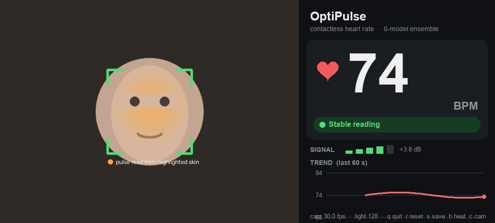
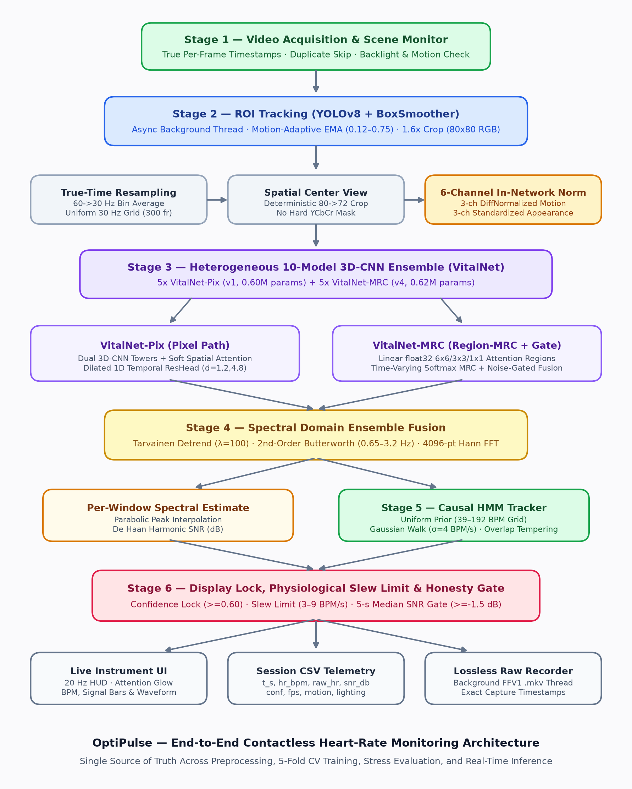

# OptiPulse

**Contactless heart-rate measurement from an ordinary webcam or phone camera.**

OptiPulse estimates heart rate in real time from the tiny colour changes that each heartbeat causes in
facial skin. This technique is called remote photoplethysmography (rPPG). On people the models never
saw during training, it is accurate to **1.45 BPM** (mean absolute error) in normal light. It runs on an
NVIDIA GPU, an Apple-silicon Mac or a plain CPU.



## How it works



1. **Face tracking.** A YOLOv8 face detector, a motion-adaptive box smoother and a stable 1.6× face crop.
2. **Real-time resampling.** The last 10 s of crops are resampled onto an exact 30 Hz timeline using each
   frame's real capture time. Cameras that deliver 12–60 fps with jitter are therefore handled correctly.
3. **VitalNet ensemble.** Two complementary families of small 3D-CNNs (~0.6 M parameters each) turn the
   clip into a pulse waveform:
   * **VitalNet-Pix** uses an appearance-attention pixel path.
   * **VitalNet-MRC** adds a linear-first, region-wise maximal-ratio-combining branch with noise-gated
     fusion. It is trained with a cross-illumination consistency loss.
4. **Spectral fusion and tracking.** The models' power spectra are fused, and a causal HMM tracker with
   no heart-rate prior decodes them into a heart rate and a confidence.
5. **Honest display.** A number is shown only after the tracker locks. It changes no faster than a
   heart can. It is **hidden when the pulse signal is too weak** to trust.

## Quick start

| Platform | Command |
|---|---|
| Windows (NVIDIA GPU or CPU) | double-click `launchers\windows\run_windows.bat` |
| macOS (Apple silicon or Intel) | `bash launchers/macos/run_mac.sh` |
| Any OS, manually | `pip install torch -r requirements.txt`, then `python -m optipulse --ensemble 2` |

The first launcher run creates a private `.venv` and installs everything (1.5–3 GB, 5–15 min). Sit
50–70 cm from the camera with light **in front** of you. The first reading appears after 8–15 s. Press
`q` to quit.

Useful options:

```bash
python -m optipulse --list_cameras                       # find your camera index
python -m optipulse --camera 1 --ensemble 2              # another camera, 2 models (laptop CPU)
python -m optipulse --always_show --save_raw auto        # show weak readings in amber, keep a lossless recording
python -m optipulse --video outputs/raw_<time>.mkv --headless --csv out.csv   # replay a recording offline
```

Every option, the window elements, the CSV log and troubleshooting are covered in **[docs/USAGE.md](docs/USAGE.md)**.

## Results

MAE in BPM on UBFC-rPPG, from 5-fold subject-wise cross-validation. Every subject is scored only by
models that never saw that person. The results cover 43 subjects with reliable ground truth, in 10-s
windows. Low light, motion and 12 fps are simulated stress tests.

| Method | Normal | Low light | Motion | Low light + motion | 12 fps |
|---|---|---|---|---|---|
| POS (classical baseline) | 20.56 | 25.97 | 29.17 | 27.64 | 22.74 |
| VitalNet-Pix, single model | 1.42 | 10.91 | 4.06 | 11.47 | 1.50 |
| **OptiPulse full system** | **1.45** | **7.55** | **3.12** | **8.23** | **1.59** |

| End-to-end live app on the raw videos | MAE (BPM) | Within 5 BPM |
|---|---|---|
| Previous system (PhysFormerX transformer) | 6.81 | 63.4 % |
| **OptiPulse** | **1.59** | **95.9 %** |
| OptiPulse, readings that pass the honesty gate (95 % of them) | 1.17 | – |

All tables, ablations and figures are in [results/RESULTS.md](results/RESULTS.md).

**Limitations.**
* Everything was validated on a single dataset (UBFC-rPPG): seated, indoor, mostly lighter skin tones.
* The low-light and motion conditions are simulated.
* On real webcams the pulse signal is often much weaker than in the dataset, and real-world accuracy
  against a reference device has not yet been measured (see [docs/FUTURE_WORK.md](docs/FUTURE_WORK.md)).
* **This is a research prototype, not a medical device.**

## Repository layout

```text
optipulse/      the system: face tracking, VitalNet, signal processing, tracker, live app (python -m optipulse)
models/         trained weights: models/vitalnet/{pix,mrc}_fold{0-4}.pt + YOLOv8 face detector
launchers/      one-click starters for Windows and macOS
pipeline/       offline pipeline: preprocess → audit → train → evaluate → report
results/        RESULTS.md, figures/, metrics/ (raw JSON of every evaluation)
docs/           documentation, final report and presentation
outputs/        created at run time (git-ignored): HR logs, raw recordings, screenshots
data/           not distributed (git-ignored): UBFC-rPPG dataset, only needed to train or evaluate
```

## Documentation

| | |
|---|---|
| [docs/EXPLAIN.md](docs/EXPLAIN.md) | **Start here as a developer.** How the system and the code work, module by module |
| [docs/USAGE.md](docs/USAGE.md) | Installation, all options, the UI, log files, testing, troubleshooting |
| [docs/METHOD.md](docs/METHOD.md) | Method write-up: contributions, evaluation protocol, limitations |
| [results/RESULTS.md](results/RESULTS.md) | Every result table and figure |
| [docs/FUTURE_WORK.md](docs/FUTURE_WORK.md) | Open problems and next steps |
| [docs/DEVELOPMENT_LOG.md](docs/DEVELOPMENT_LOG.md) | Chronological lab notebook |
| [docs/report/](docs/report/) · [docs/presentation/](docs/presentation/) | Final UGP report (PDF + LaTeX) and slides |

## Reproducing the results

Reproduction needs an NVIDIA GPU and the [UBFC-rPPG](https://sites.google.com/view/ybenezeth/ubfcrppg)
dataset, placed flat in `data/raw/UBFC-rPPG/` as `vid_<name>.avi` + `ground_truth_<name>.txt` pairs.
From the repository root:

```bash
EXCL=sub3,sub4,sub11,sub14,sub18,sub20,sub24     # subjects whose ground truth fails the audit

python pipeline/preprocess_ubfc.py               # face crops + aligned PPG at 30 Hz → data/processed/ubfc_v2/
python pipeline/audit_dataset.py --skip_legacy   # ground-truth audit → results/metrics/dataset_audit.json
python pipeline/train_cv.py --version 1 --pair_w 0   --exclude_train $EXCL --prefix pix_ --report results/metrics/cv_results_pix.json
python pipeline/train_cv.py --version 4 --pair_w 0.5 --exclude_train $EXCL --prefix mrc_ --report results/metrics/cv_results_mrc.json
python pipeline/eval_tracking.py --models "models/vitalnet/pix_*.pt" --tag pix
python pipeline/eval_tracking.py --models "models/vitalnet/mrc_*.pt" --tag mrc
python pipeline/eval_tracking.py --models "models/vitalnet/pix_*.pt,models/vitalnet/mrc_*.pt" --tag system
python pipeline/eval_tracking.py --models "models/vitalnet/pix_*.pt,models/vitalnet/mrc_*.pt" --tag system_never_trained --never_trained $EXCL
python pipeline/compare_pipelines.py             # the complete live app on every video
python pipeline/make_report.py                   # → results/RESULTS.md + results/figures/
```

On Windows, use `set EXCL=...` and `%EXCL%`. The run takes about 5 h on an RTX 3070 Ti Laptop.
Training overwrites `models/vitalnet/`. A quick check needs only one subject:
`python -m optipulse --ubfc sub42 --weights models/vitalnet/pix_fold0.pt models/vitalnet/mrc_fold0.pt --headless`
should give an MAE of 0.64 BPM.

## Data and privacy

* **UBFC-rPPG** (Bobbia et al., *Pattern Recognition Letters*, 2019) is not included; obtain it from its
  authors. Under the dataset's terms, subjects 21 and 27 must not appear in publications, and frames of
  subject 27 must never be published.
* **`outputs/`** contains recordings and screenshots of real faces. It is git-ignored; do not commit or
  share its contents without consent.

## Team

Undergraduate Project (UGP), Department of Design: Jayant Mitawa, Priyen Parmar, Satwik Raj Wadhwa,
Divyansh Bansal, Anuj Agrawal.
