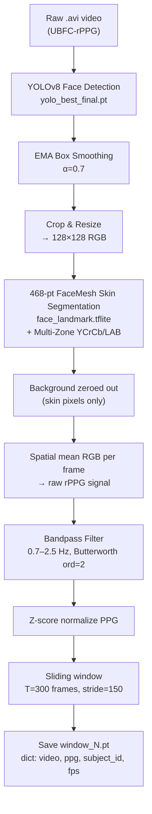

# CS776 Project — Complete Dataset Description

> [!IMPORTANT]
> This document describes **all raw, intermediate, and preprocessed data** used in the VitalEye rPPG (remote photoplethysmography) heart-rate estimation project. Use this as the reference before writing any training/evaluation script.

---

## 1. Source Dataset: UBFC-rPPG

The project uses the publicly available **UBFC-rPPG** dataset.

- **Official site**: https://sites.google.com/view/ybenezeth/ubfcrppg
- **Contact**: yannick.benezeth@u-bourgogne.fr
- **Task**: Remote heart rate (HR) estimation from facial video using photoplethysmography (rPPG)
- **Ground truth device**: Pulse oximeter (CMS50E) capturing PPG signal, HR, and SpO2

> [!NOTE]
> For subjects 21 and 27 in Dataset2: Facial images must NOT be included in any publication, presentation, or report (privacy restriction from dataset authors).

---

## 2. Raw Data Location

All raw data lives under two folders at `e:\CS776 Project\`:

```
e:\CS776 Project\
├── Dataset\          ← Raw UBFC-rPPG (Dataset1 + Dataset2 flat)
└── Dataset2\         ← Preprocessed per-subject crop outputs (face/nose/chest)
```

---

## 3. `Dataset\` — Raw UBFC-rPPG Files

**Path**: `e:\CS776 Project\Dataset\`  
**Total size**: ~283 MB  
**Format**: Flat directory — all files at one level (no subdirectories)

### 3.1 Dataset1 (8 subjects)

These are the **original single-subject** recordings with varying conditions (rest, different lighting, one post-exercise session).

| File Pattern | Count | Description |
|---|---|---|
| `vid_1_<id>.avi` | 8 | Raw face video |
| `ground_truth_1_<id>.txt` | 8 | Ground truth from pulse oximeter |

**Subject IDs**: `5gt`, `6gt`, `7gt`, `8gt`, `10gt`, `11gt`, `12gt`, `after_exercise`

#### Ground Truth Format — Dataset1 (`.txt`)
Tab/space-separated, one row per sample at ~30 fps:

```
Column 1: Timestep (ms)
Column 2: Heart rate (HR, bpm)
Column 3: SpO2 (%)
Column 4: PPG signal (raw integer)
```

**Example** (`ground_truth_1_10gt.txt`):
```
14    74    96    40
30    74    96    40
47    74    96    38
...
```

---

### 3.2 Dataset2 (42 subjects)

Larger cohort with subjects recorded in a controlled indoor setting.

| File Pattern | Count | Description |
|---|---|---|
| `vid_2_sub<N>.avi` | 42 | Raw face video |
| `ground_truth_2_sub<N>.txt` | 42 | Ground truth from pulse oximeter |

**Subject IDs**: `1, 3, 4, 5, 8, 9, 10, 11, 12, 13, 14, 15, 16, 17, 18, 20, 22, 23, 24, 25, 26, 27, 30, 31, 32, 33, 34, 35, 36, 37, 38, 39, 40, 41, 42, 43, 44, 45, 46, 47, 48, 49`  
*(Note: subject IDs 2, 6, 7, 19, 21, 28, 29 are absent/excluded)*

#### Ground Truth Format — Dataset2 (`.txt`)
Three rows in the file (space-separated values in scientific notation):

```
Line 1: PPG signal values (normalized, float, one per timestep)
Line 2: Heart rate (HR, bpm) values (one per timestep)
Line 3: Timestep (seconds, scientific notation, e.g. 4.2332000e+01)
```

**Key note from readme**: HR values from the sensor are **not** used for evaluation. HR is estimated from the PPG signal for fair comparison.

---

## 4. `Dataset2\output_folder\` — Per-Subject Video Crops

**Path**: `e:\CS776 Project\Dataset2\output_folder\`  
**Structure**: One subdirectory per subject (50 total — both Dataset1 and Dataset2 subjects)

```
Dataset2/
└── output_folder/
    ├── vid_1_10gt/
    │   ├── face.mp4                    ← Cropped face region
    │   ├── nose.mp4                    ← Cropped nose region
    │   ├── chest.mp4                   ← Cropped chest region
    │   └── ground_truth_1_10gt.txt     ← Copied GT file
    ├── vid_1_11gt/ ...
    ├── vid_2_sub1/
    │   ├── face.mp4
    │   ├── nose.mp4
    │   ├── chest.mp4
    │   └── ground_truth_2_sub1.txt
    └── vid_2_sub49/ ...
```

**Total subjects in output_folder**: 50 (8 from Dataset1 + 42 from Dataset2)

Each subject folder always contains exactly **4 files**:
| File | Description |
|---|---|
| `face.mp4` | Cropped & tracked face ROI video |
| `nose.mp4` | Cropped nose region video |
| `chest.mp4` | Cropped chest region video |
| `ground_truth_*.txt` | Original ground truth (same format as Dataset\ raw) |

---

## 5. Preprocessed Data — PyTorch Window Files

Three versions of preprocessed sliding-window `.pt` files exist, each representing a different preprocessing pipeline or feature set. All are stored as flat directories of numbered files.

### 5.1 Summary Table

| Folder | Path | Windows | Size | Keys in each `.pt` |
|---|---|---|---|---|
| `preprocessed_vidformer` | `e:\CS776 Project\preprocessed_vidformer\` | 593 | 8.15 GB | `video`, `ppg`, `subject_id`, `fps` |
| `preprocessed_vidformer1` | `e:\CS776 Project\preprocessed_vidformer1\` | 593 | 8.15 GB | `video`, `ppg`, `subject_id`, `fps` |
| `preprocessed_vidformer2` | `e:\CS776 Project\preprocessed_vidformer2\` | 593 | 10.18 GB | `video`, `chest_video`, `ppg`, `resp`, `hr_bpm`, `rr_bpm`, `subject_id`, `fps` |

### 5.2 File Naming Convention

```
window_0.pt
window_1.pt
...
window_592.pt
```

Files are numbered sequentially across **all subjects** in a fixed order. There is **no train/val/test split** baked in — the split must be done at the subject level in the script.

---

### 5.3 Per-Window Tensor Details

#### `preprocessed_vidformer` and `preprocessed_vidformer1` (Face only)

```python
{
    'video':      torch.Tensor  # shape (3, 300, 128, 128) | dtype: uint8
                                # C=RGB, T=frames, H=128, W=128
                                # This is the FACE crop with skin segmentation
    'ppg':        torch.Tensor  # shape (300,) | dtype: float32
                                # Bandpass-filtered, z-score normalized PPG signal
                                # Corresponds frame-by-frame to 'video'
    'subject_id': str           # e.g. 'ds1_10gt', 'sub1', 'sub49'
    'fps':        float         # e.g. 28.672 (varies per subject/video)
}
```

> [!NOTE]
> `preprocessed_vidformer` and `preprocessed_vidformer1` differ only in the skin segmentation mask applied (one may use the standard YOLO-based face crop, the other the upgraded Hybrid Anatomical FaceMesh). Both have the same tensor schema and 593 windows.

#### `preprocessed_vidformer2` (Face + Chest, multi-signal)

```python
{
    'video':       torch.Tensor  # shape (3, 300, 128, 128) | dtype: uint8  — Face crop
    'chest_video': torch.Tensor  # shape (3, 300,  64,  64) | dtype: uint8  — Chest crop (smaller)
    'ppg':         torch.Tensor  # shape (300,) | dtype: float32 — Filtered PPG signal
    'resp':        torch.Tensor  # shape (300,) | dtype: float32 — Respiration signal (from chest)
    'hr_bpm':      float         # Scalar — mean HR in BPM for this window
    'rr_bpm':      float         # Scalar — mean Respiratory Rate in BPM for this window
    'subject_id':  str           # e.g. 'ds1_10gt', 'sub1'
    'fps':         float         # e.g. 28.0
}
```

---

### 5.4 Windowing Parameters (from `preprocessor.py`)

| Parameter | Value | Meaning |
|---|---|---|
| `SEQ_LENGTH` | 300 | Frames per window (~10s at 30fps) |
| `FACE_SIZE` | 128 | Face crop spatial resolution (px) |
| `STRIDE` | 150 | Stride between windows (50% overlap) |
| `BP_LO` | 0.7 Hz | Bandpass low cutoff (~42 BPM) |
| `BP_HI` | 2.5 Hz | Bandpass high cutoff (~150 BPM) |
| `BP_ORDER` | 2 | Butterworth filter order |
| `EMA_ALPHA` | 0.7 | Face bounding box smoothing (EMA) |

---

### 5.5 Subject-to-Window Mapping (all three preprocessed folders)

All three folders share the **same 593-window sequence** and subject assignments:

| Subject ID | Windows | Source Dataset |
|---|---|---|
| `ds1_10gt` | 7 | Dataset1 |
| `ds1_11gt` | 14 | Dataset1 |
| `ds1_12gt` | 14 | Dataset1 |
| `ds1_5gt` | 15 | Dataset1 |
| `ds1_6gt` | 14 | Dataset1 |
| `ds1_7gt` | 14 | Dataset1 |
| `ds1_8gt` | 13 | Dataset1 |
| `ds1_after_exercise` | 21 | Dataset1 |
| `sub1` | 9 | Dataset2 |
| `sub10` | 12 | Dataset2 |
| `sub11` | 12 | Dataset2 |
| `sub12` | 12 | Dataset2 |
| `sub13` | 12 | Dataset2 |
| `sub14` | 12 | Dataset2 |
| `sub15` | 12 | Dataset2 |
| `sub16` | 12 | Dataset2 |
| `sub17` | 12 | Dataset2 |
| `sub18` | 12 | Dataset2 |
| `sub20` | 12 | Dataset2 |
| `sub22` | 12 | Dataset2 |
| `sub23` | 12 | Dataset2 |
| `sub24` | 12 | Dataset2 |
| `sub25` | 8 | Dataset2 |
| `sub26` | 8 | Dataset2 |
| `sub27` | 8 | Dataset2 |
| `sub3` | 11 | Dataset2 |
| `sub30` | 12 | Dataset2 |
| `sub31` | 12 | Dataset2 |
| `sub32` | 12 | Dataset2 |
| `sub33` | 12 | Dataset2 |
| `sub34` | 12 | Dataset2 |
| `sub35` | 12 | Dataset2 |
| `sub36` | 12 | Dataset2 |
| `sub37` | 12 | Dataset2 |
| `sub38` | 12 | Dataset2 |
| `sub39` | 12 | Dataset2 |
| `sub4` | 8 | Dataset2 |
| `sub40` | 12 | Dataset2 |
| `sub41` | 12 | Dataset2 |
| `sub42` | 12 | Dataset2 |
| `sub43` | 12 | Dataset2 |
| `sub44` | 12 | Dataset2 |
| `sub45` | 12 | Dataset2 |
| `sub46` | 12 | Dataset2 |
| `sub47` | 12 | Dataset2 |
| `sub48` | 12 | Dataset2 |
| `sub49` | 12 | Dataset2 |
| `sub5` | 9 | Dataset2 |
| `sub8` | 12 | Dataset2 |
| `sub9` | 12 | Dataset2 |
| **Total** | **593** | **50 subjects** |

---

## 6. Preprocessing Pipeline Summary

The preprocessing is implemented in [`VitalEye_CS776_Deploy/preprocessor.py`](file:///e:/CS776%20Project/VitalEye_CS776_Deploy/preprocessor.py).



---

## 7. Additional Files in the Preprocessed Folders

| File | Folder | Description |
|---|---|---|
| `signal_filter_demo.png` | `preprocessed_vidformer/`, `preprocessed_vidformer1/` | Debug plot of bandpass filter output |
| `slide_img_1_original_face.png` | `preprocessed_vidformer1/` | Example original face frame |
| `slide_img_2_masked_face.png` | `preprocessed_vidformer1/` | Example after skin mask applied |

---

## 8. How to Load a Window in a Script

```python
import torch

# Load a single window
w = torch.load("e:/CS776 Project/preprocessed_vidformer2/window_0.pt",
               map_location="cpu", weights_only=False)

video      = w['video']       # (3, 300, 128, 128) uint8 — face frames
chest_vid  = w['chest_video'] # (3, 300,  64,  64) uint8 — chest frames (vidformer2 only)
ppg        = w['ppg']         # (300,) float32 — normalized PPG label
resp       = w['resp']        # (300,) float32 — respiration signal (vidformer2 only)
hr_bpm     = w['hr_bpm']      # float — mean HR for window (vidformer2 only)
subject_id = w['subject_id']  # str
fps        = w['fps']         # float

# Normalize video to float [0, 1]
video_float = video.float() / 255.0  # (3, 300, 128, 128)
```

---

## 9. Recommended Subject-Level Train/Val/Test Split

> [!WARNING]
> Always split at the **subject** level (never at the window level), to prevent data leakage. Windows from the same subject overlap by 50% and must stay together.

Suggested split (leave-out approach):

| Split | Subjects (suggested) | Windows (approx) |
|---|---|---|
| Train | 40 subjects | ~475 |
| Val | 5 subjects | ~60 |
| Test | 5 subjects | ~58 |

**Loading all windows for a subset of subjects**:

```python
import torch, glob, os

PREPROCESSED_DIR = r"e:\CS776 Project\preprocessed_vidformer2"
TRAIN_SUBJECTS = {"sub10", "sub11", "sub12", ...}  # define your split

all_files = sorted(
    glob.glob(os.path.join(PREPROCESSED_DIR, "window_*.pt")),
    key=lambda x: int(os.path.basename(x).split("window_")[1].split(".pt")[0])
)

train_windows = []
for f in all_files:
    d = torch.load(f, map_location="cpu", weights_only=False)
    if d["subject_id"] in TRAIN_SUBJECTS:
        train_windows.append(f)
```

---

## 10. Full Directory Tree (Annotated)

```
e:\CS776 Project\
│
├── Dataset\                            ← RAW UBFC-rPPG (flat, 283 MB)
│   ├── vid_1_5gt.avi                   ← Dataset1 video (8 total)
│   ├── ground_truth_1_5gt.txt          ← Dataset1 GT: col=timestamp,HR,SpO2,PPG
│   ├── vid_2_sub1.avi                  ← Dataset2 video (42 total)
│   ├── ground_truth_2_sub1.txt         ← Dataset2 GT: row1=PPG, row2=HR, row3=time
│   └── readme.txt                      ← Official UBFC-rPPG readme
│
├── Dataset2\                           ← INTERMEDIATE: per-subject crop outputs
│   └── output_folder\
│       ├── vid_1_10gt\
│       │   ├── face.mp4                ← Face crop (H×W, 30fps)
│       │   ├── nose.mp4                ← Nose crop
│       │   ├── chest.mp4               ← Chest crop
│       │   └── ground_truth_1_10gt.txt
│       └── vid_2_sub<N>\  × 42         ← Same structure for Dataset2
│
├── preprocessed_vidformer\             ← PREPROCESSED v1 (8.15 GB, 593 windows)
│   ├── window_0.pt → window_592.pt     ← Keys: video(3,300,128,128), ppg(300,), subject_id, fps
│   └── signal_filter_demo.png
│
├── preprocessed_vidformer1\            ← PREPROCESSED v2 (8.15 GB, 593 windows)
│   ├── window_0.pt → window_592.pt     ← Same schema as v1 (upgraded skin segmentation)
│   ├── slide_img_1_original_face.png
│   └── slide_img_2_masked_face.png
│
├── preprocessed_vidformer2\            ← PREPROCESSED v3 (10.18 GB, 593 windows)
│   └── window_0.pt → window_592.pt     ← Keys: video, chest_video(3,300,64,64),
│                                               ppg, resp, hr_bpm, rr_bpm, subject_id, fps
│
├── VitalEye_CS776_Deploy\              ← DEPLOY package
│   ├── preprocessor.py                 ← Full preprocessing pipeline source
│   ├── physformer.py                   ← PhysFormer model definition
│   ├── pipeline.py                     ← Inference pipeline
│   ├── models\
│   │   ├── face_landmark.tflite        ← 468-pt FaceMesh model
│   │   ├── vidformer.pt                ← Trained model weights (8.1 MB)
│   │   └── yolov8\weights\             ← YOLOv8 face detector weights
│   └── ...
│
├── best.pt                             ← YOLO face detector checkpoint (52 MB)
├── checkpoint_ep*.pt                   ← rPPG model training checkpoints
├── ckpt_ep*.pt                         ← Later training checkpoints (vidformer)
├── dual_*.pt                           ← Dual-stream model checkpoints
└── yolo_best_final.pt                  ← Best YOLO model (22 MB)
```

---

## 11. Quick Reference

| Question | Answer |
|---|---|
| How many total subjects? | **50** (8 Dataset1 + 42 Dataset2) |
| How many preprocessed windows? | **593** per folder |
| Window duration | **300 frames** (~10 sec at 30 fps) |
| Window overlap | **50%** (stride = 150 frames) |
| Face video tensor shape | **(3, 300, 128, 128)** — RGB, uint8 |
| Chest video tensor shape | **(3, 300, 64, 64)** — only in `vidformer2` |
| PPG signal shape | **(300,)** — float32, bandpass filtered, z-normalized |
| Subject ID format (Dataset1) | `ds1_<id>` e.g. `ds1_10gt`, `ds1_after_exercise` |
| Subject ID format (Dataset2) | `sub<N>` e.g. `sub1`, `sub49` |
| Which preprocessed folder to use? | `preprocessed_vidformer2` for multi-signal; `preprocessed_vidformer1` for face-only (better skin mask) |
