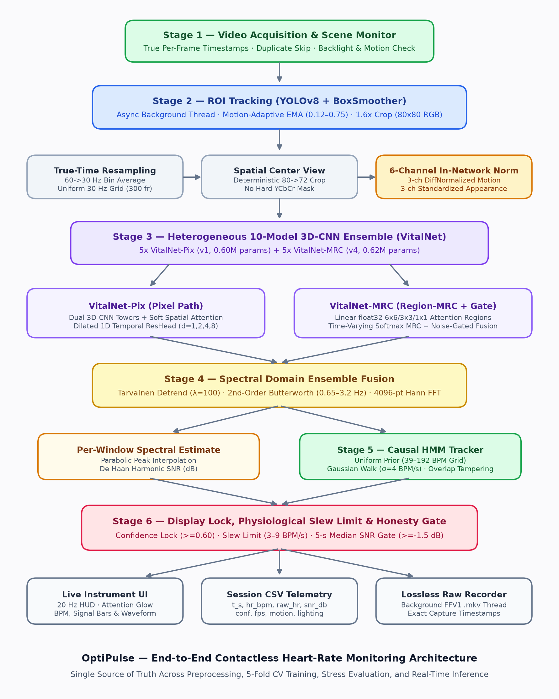

# OptiPulse: a guide to the project and its code

This guide is for someone joining the project: a new contributor, a reviewer, or a future maintainer.
After reading it you should know what every part of the repository does, how data flows from a
camera frame to the number on screen, how the models were trained and evaluated, which design rules
hold the system together, and where to start when you want to change something.

It assumes you know basic Python and NumPy and have seen a convolutional network before. No prior
knowledge of heart-rate sensing or signal processing is needed.

**Suggested reading paths**

| You want to... | Read |
|---|---|
| understand the project in 15 minutes | §1, §2, §3 |
| run it and poke at it | §4, then [USAGE.md](USAGE.md) |
| change the live app | §5, §6, §10, §11 |
| change or retrain a model | §6.4–§6.6, §7, §8, §10 |
| understand or reproduce the numbers | §8, §9, [../results/RESULTS.md](../results/RESULTS.md) |

---

## Contents

1. [What the project does](#1-what-the-project-does)
2. [The physics in brief](#2-the-physics-in-brief)
3. [Architecture: one package, three ways to run it](#3-architecture-one-package-three-ways-to-run-it)
4. [Getting set up](#4-getting-set-up)
5. [The live app, step by step](#5-the-live-app-step-by-step)
6. [Module reference: `optipulse/`](#6-module-reference-optipulse)
7. [The offline pipeline: `pipeline/`](#7-the-offline-pipeline-pipeline)
8. [How the system is evaluated](#8-how-the-system-is-evaluated)
9. [Results and what they mean](#9-results-and-what-they-mean)
10. [Design rules you should not break](#10-design-rules-you-should-not-break)
11. [Common tasks](#11-common-tasks)
12. [Design FAQ](#12-design-faq)
13. [Limitations and known issues](#13-limitations-and-known-issues)
14. [Glossary](#14-glossary)

---

## 1. What the project does

**OptiPulse measures a person's heart rate from an ordinary webcam or phone camera, without touching
them.** The technique is called *remote photoplethysmography* (rPPG).

In one sentence per stage:

1. A **YOLOv8 face detector** finds the face; a smoother removes detector jitter; a square crop around
   the face is cut out of every frame.
2. The last **10 seconds** of crops are resampled onto an exact **30 Hz** timeline using each frame's real
   capture time.
3. An **ensemble of small 3D-CNNs (VitalNet)** turns that clip into a **pulse waveform**.
4. Classical signal processing finds the waveform's **dominant frequency** (the heart rate) and how
   clearly it stands out (the **SNR**).
5. A causal **HMM tracker** combines successive estimates so that random noise peaks do not make the
   number jump around.
6. Display logic decides **whether to show the number at all** (the *honesty gate*) and how fast it may
   change.

The models were trained on the public **UBFC-rPPG** dataset (50 videos of seated people, with a finger
pulse sensor as ground truth). On people the models never saw during training, the error is about
**1.45 BPM** in normal light.



---

## 2. The physics in brief

* **PPG** (photoplethysmography) is what a finger pulse oximeter does: blood absorbs light (green most
  strongly), so each heartbeat, which pushes more blood into the skin, slightly darkens the reflected
  light.
* **Remote PPG** sees the same effect on facial skin with ambient light and a camera. The change is
  **tiny**: about **0.2–1 % of pixel brightness**. One 8-bit pixel step is 0.4 % of mid-grey, so in a
  single pixel the pulse is below the camera's own noise.
* That is why the system **averages many pixels** (noise cancels, the pulse does not) over **many frames**
  (10 s windows). The network learns which pixels to trust: cheeks and forehead help; hair, eyes and
  background do not.
* **Heart rate is a frequency.** 1.2 oscillations per second = 1.2 × 60 = 72 BPM. Only
  **0.65–3.2 Hz (39–192 BPM)** is considered (the *HR band*).
* **What competes with the pulse:** head motion, lighting changes (flicker, camera auto-exposure and
  white balance), sensor noise in the dark, and video compression. All of them are far larger than 0.3 %.
  Most of the engineering in this repository exists to pull a 0.3 % signal out of that.

---

## 3. Architecture: one package, three ways to run it

All logic lives in a single Python package, **`optipulse/`**. The same functions are used in three
contexts, which is the most important structural fact about the codebase:

```text
                         ┌──────────────────────── optipulse/ ────────────────────────┐
                         │  face.py   dsp.py   model.py   tracking.py   live.py  ui.py │
                         │  data.py   augment.py   ubfc.py   evaluation.py   paths.py  │
                         └────────────────────────────────────────────────────────────┘
                              ▲                        ▲                        ▲
   1. LIVE APP                │   2. TRAINING          │   3. EVALUATION        │
   python -m optipulse ───────┘   pipeline/            │   pipeline/            │
   (app.py: camera → engine       preprocess_ubfc.py ──┘   eval_tracking.py ────┘
    → UI, CSV log)                train_cv.py              compare_pipelines.py
                                                           make_report.py
```

The face crop used for training is produced by the same `BoxSmoother` + `crop_square` as the live
app; the HR estimator applied to the ground-truth PPG is the same `hr_from_signal` applied to the
network output; the 80→72 view used at evaluation is the same `to_model_input` used live. The previous
version of this project failed in practice largely because training and live preprocessing had drifted
apart, so this rule is deliberate (§10).

### Repository map

```text
HeartRate/
├── optipulse/            the system: library + live app (python -m optipulse)
├── models/
│   ├── vitalnet/         10 trained checkpoints: pix_fold0-4.pt, mrc_fold0-4.pt (~2.5 MB each)
│   └── face_detector/    yolov8_face_nose_chest.pt (50 MB; classes face / nose / chest, only "face" is used)
├── launchers/
│   ├── windows/run_windows.bat   one-click setup + run (CUDA or CPU PyTorch)
│   └── macos/run_mac.sh          one-command setup + run (Apple GPU or CPU)
├── pipeline/             offline scripts: preprocess → audit → train → evaluate → report
├── results/
│   ├── RESULTS.md        every result table (generated by pipeline/make_report.py)
│   ├── figures/          plots and diagrams
│   └── metrics/          raw JSON outputs of every evaluation run (inputs to make_report.py)
├── docs/                 documentation (index: docs/README.md)
├── requirements.txt
├── outputs/              created at run time, git-ignored: HR logs, raw recordings, screenshots
└── data/                 git-ignored, not distributed: UBFC-rPPG raw videos + preprocessed cache
```

To **run** the system you need `optipulse/`, `models/` and Python. To **retrain or re-evaluate** you
also need `pipeline/`, an NVIDIA GPU, and the dataset in `data/`.

---

## 4. Getting set up

```bash
# from the repository root
python -m venv .venv && source .venv/bin/activate        # Windows: .venv\Scripts\activate
pip install torch torchvision                            # NVIDIA: use the CUDA wheel, see pytorch.org
pip install -r requirements.txt

python -m optipulse --help                               # every option
python -m optipulse --list_cameras                       # which camera indices work
python -m optipulse --ensemble 2                         # live, 2 models (fine on a laptop CPU)
```

The launchers in `launchers/` do all of this automatically (details in [USAGE.md](USAGE.md)). Always
run from the **repository root**: the package resolves model and output paths relative to its own
location (`optipulse/paths.py`), but `python -m optipulse` must be able to import the package.

**A good first hour:**

1. Run the app on your webcam with `--ensemble 2 --always_show --save_raw auto`. Sit with a lamp in
   front of you, wait ~15 s, press `q`.
2. Open the CSV it wrote in `outputs/` and look at `hr_bpm`, `snr_db`, `confidence` and `shown`.
3. Replay your own recording headless:
   `python -m optipulse --video outputs/raw_<time>.mkv --headless --csv /tmp/replay.csv`.
   This reproduces the live session exactly, using the saved capture timestamps. It is the main tool
   for debugging the live path without a camera.
4. Read `optipulse/live.py` (209 lines) top to bottom. It is the heart of the system and touches almost
   every other module.

---

## 5. The live app, step by step

Entry point: `python -m optipulse` → `optipulse/__main__.py` → `app.cli()` → `app.run(args)`.

### 5.1 Startup (`app.run`)

1. **`pick_device`** chooses where the networks run: CUDA if available; otherwise the Apple GPU (MPS)
   **only if** a full engine pass on random input gives the same waveform on MPS as on the CPU (within
   2 %); otherwise the CPU. On the CPU, PyTorch is limited to all cores but two, so camera and UI keep up.
2. **`load_ensemble`** loads up to `--ensemble N` checkpoints from `models/vitalnet/`, **alternating
   families** (`mrc_fold0, pix_fold0, mrc_fold1, ...`) so any small subset contains both model types.
   `--weights a.pt b.pt` overrides this.
3. **`FaceDetector`** loads YOLOv8 (input size 320, confidence 0.30). If Ultralytics or the weights are
   missing it falls back to OpenCV's Haar cascade. If YOLO fails on MPS it switches itself to CPU.
4. **`HREngine`**, **`BoxSmoother`**, **`LiveUI`** and **`SceneMonitor`** are created; the CSV log is
   opened; with `--save_raw` a raw recorder is prepared.

### 5.2 Threads

| Thread | Class / function | Job |
|---|---|---|
| Camera | `app.Camera._loop` | Reads frames as fast as the camera delivers, stamps each with `time.perf_counter()`, keeps a queue of up to 45 frames (~1.5 s) and drops the *oldest* if the main loop falls behind. |
| Face (CPU / Apple only) | `app.AsyncFace` | Runs YOLO on the newest frame at most 4 Hz (CPU) or 8 Hz (MPS) so the slow detector never blocks the camera loop. On CUDA, detection runs inline every `det_every` frames (auto: every 2nd frame at 30 fps, 4th at 60 fps). |
| Inference | `HREngine.infer_async` | Runs the networks on a snapshot of the buffer. If the previous inference is still running, the request is skipped. |
| Raw recorder | `app.RawRecorder` | Writes untouched frames to a lossless FFV1 `.mkv` (MJPG `.avi` fallback) from a bounded queue. |
| Main | `app.run` loop | Glues everything together; redraws the UI at most 20 times per second. |

### 5.3 Per frame (main loop)

```text
camera frame + timestamp
  ├─ optional raw recording (frame + timestamp row)
  ├─ face box: AsyncFace (CPU/MPS) or inline detect (CUDA/offline) → BoxSmoother.update
  ├─ duplicate check: identical 1/8-downsampled frame → skip (virtual cameras repeat frames)
  ├─ SceneMonitor.update_box (head-motion history)
  └─ crop_square(frame, box) → 80×80 RGB → HREngine.push(ts, crop)
```

* **Real timestamps matter.** Webcams rarely deliver a steady 30 fps; a test MacBook delivered 24 fps
  with 137 gaps of 0.1–0.35 s in one minute. If you *assumed* 30 fps while the camera gave 24, every
  heart rate would come out 25 % too high. Every frame therefore keeps its capture time, and the
  engine resamples using those times.
* **`BoxSmoother`** (`face.py`) is a motion-adaptive exponential moving average over (centre x, centre y,
  size). Small displacements (jitter) get factor 0.12 (heavy smoothing); displacements of ≥ 8 % of the
  face size (real motion) get up to 0.75 (fast follow). Size changes are capped at 0.25 because zoom
  jitter is especially harmful. A jittering crop creates brightness changes far larger than the pulse.
* **`crop_square`** cuts a square **1.6× the face box** (forehead, cheeks, chin, a little background)
  with one affine warp (replicate border near image edges) and returns **RGB**. There is **no hard skin
  mask**: the old system's YCbCr mask flickered and was itself a noise source; the network learns a
  soft one instead (§6.4).
* If no face is seen for > 1 s, the box and the engine buffer are reset.

### 5.4 Every 0.5 s (`HREngine.infer`)

Triggered when a face is present, `--update` seconds have passed and at least `--min_window` (6 s) is
buffered.

1. Take the last ≤ 10 s (`--window`) of `(timestamp, crop)` pairs. The buffer is cleared whenever two
   frames are > 1 s apart (stall or lost face): a signal with a hole gives a wrong spectrum.
2. If the effective rate is > 39 fps (1.3 × 30, e.g. a 60 fps phone), **`bin_average`** averages all
   frames that fall into the same 1/30-s slot instead of discarding them (noise drops by √k).
3. **`dsp.resample_uniform`** linearly interpolates the crops onto an exact 30 Hz grid → 300 frames.
4. Cast to **float32** (Apple's MPS cannot hold float64), scale to [0, 1], reshape to `[1, 3, T, 80, 80]`.
5. **`data.to_model_input`**: deterministic centre zoom 0.93 → `[1, 3, T, 72, 72]`. 0.93 is the middle of
   the training zoom range (0.86–1.0), so the live view looks like an average training sample.
6. Every model produces a waveform `[T]` (bf16 autocast on CUDA). The **last** model also returns its
   attention map, which the UI draws as the warm glow on the face.
7. **`dsp.hr_from_waves(waves, 30, "median")`** → raw HR (median of per-model peaks), SNR (median of
   per-model SNRs) and a fused waveform for display.
8. **`tracking.band_psd(waves)`** → the models' band-normalised power spectra averaged on a 1-BPM grid →
   **`HRTracker.update`** → tracked HR + confidence.
9. Display logic (§5.5).

### 5.5 What the screen shows (`HREngine`)

| Stage | Rule | Why |
|---|---|---|
| **Lock** | No number until tracker confidence ≥ 0.60, or 20 s have passed. | Avoids showing the first, unreliable estimates. |
| **Slew limit** | After locking, the displayed value moves at most 3 BPM/s, or 9 BPM/s when confidence ≥ 0.75. | A heart cannot jump 50 → 120 in one second; post-exercise recovery (~1–2 BPM/s) is still followed. It limits *speed*, never the *value*. |
| **Honesty gate** (`HREngine.showing`) | Show only if the **5-s median SNR ≥ −1.5 dB**. | A confident-looking wrong number is worse than none. On the dataset this hides 5 % of readings and lowers the error of the rest from 1.59 to 1.17 BPM. |

`--always_show` turns the gate into a colour code: weak readings are shown in amber as "Low confidence
reading" instead of being hidden. `--no_track` bypasses the tracker: the number becomes the median of
the last 6 per-window estimates with SNR ≥ `--snr_min`.

### 5.6 The window (`ui.LiveUI.render`)

* **Left:** the camera image with corner brackets around the face and the attention glow (computed on a
  96×96 grid and scaled up, because doing it at full size starved the pulse loop on close faces).
* **Right (420 px panel):** big BPM with a heart beating at that rate; a **state chip**; **signal bars**;
  a 60-s trend; the live pulse waveform; a hint line; a footer with fps and brightness.

UI states (`LiveUI.state`):

| State | Condition | Chip |
|---|---|---|
| `noface` | no face box | red "No face found" |
| `measuring` | tracker not yet locked | blue "Measuring..." with countdown |
| `nopulse` | locked but `showing` is false (gate closed) | red "Pulse signal too weak – no reading" |
| `good` | SNR ≥ 0 dB, confidence ≥ 0.60 and 5-s SNR ≥ −1.5 dB | green "Stable reading" |
| `weak` | anything else that is shown | amber "Low confidence reading" |

Signal bars = number of thresholds (−4, −2, 0, +2, +4 dB) that the 5-s median SNR exceeds. Hints are
chosen from measurements, in priority order: too dark (brightness < 60), too close (1.6× box > 95 % of
frame height), too far (box < 18 %), low fps (< 20), head moving (`SceneMonitor`), backlit
(`SceneMonitor`), otherwise a generic weak-pulse hint.

Keys: `q`/Esc quit · `r` reset · `s` screenshot · `f` fullscreen · `h` glow on/off · `c` camera driver
dialog (Windows only).

### 5.7 Outputs

* **`outputs/hr_log_<time>.csv`**, one row per finished inference: `t_s, hr_bpm, raw_hr_bpm, snr_db,
  confidence, rppg_fps, shown`, then `gt_hr_bpm` (only with `--ubfc`), then `snr_avg_db, head_motion,
  face_light, bg_light`. Column meanings are in [USAGE.md](USAGE.md#the-csv-log).
* **`outputs/raw_<time>.mkv` + `raw_<time>_timestamps.csv`** with `--save_raw auto`: the untouched frames
  and their capture times. `--video` on such a file automatically uses the real timestamps.
* **`outputs/screenshot_<time>.png`** on `s`.

`outputs/` contains images of real faces. It is git-ignored; never commit or publish it.

### 5.8 Offline modes of the same app

* `--video file` replays a file through the exact live path (detection runs inline; inference is
  synchronous, so results are deterministic).
* `--ubfc subN` replays a UBFC video, uses its ground-truth timestamps, adds the ground-truth HR to the
  CSV and prints MAE at the end. This is how `pipeline/compare_pipelines.py` scores the whole app.

---

## 6. Module reference: `optipulse/`

Line counts are approximate; the whole package is ~2,100 lines.

### 6.1 `__init__.py` and `paths.py`: constants

| Constant | Value | Meaning |
|---|---|---|
| `TARGET_FPS` | 30.0 | every clip, training and live, is resampled to 30 Hz |
| `CROP_SIZE` | 80 | stored crop size |
| `INPUT_SIZE` | 72 | network input size (80 → 72 view) |
| `BOX_SCALE` | 1.6 | face-box enlargement |
| `HR_LO_HZ`, `HR_HI_HZ` | 0.65, 3.2 | HR band, 39–192 BPM, identical for labels and predictions |

`paths.py` defines every folder the project reads or writes (`MODELS_DIR`, `VITALNET_DIR`,
`FACE_DETECTOR`, `RESULTS_DIR`, `METRICS_DIR`, `FIGURES_DIR`, `OUTPUTS_DIR`, `DATA_DIR`, `UBFC_RAW_DIR`,
`UBFC_PROCESSED_DIR`, ...), all relative to the repository root. Never hard-code a path elsewhere.

### 6.2 `app.py`: the live application (~530 lines)

| Name | Role |
|---|---|
| `cli()`, `parse()` | command-line entry point and all options |
| `run(args)` | the main loop (§5); returns `{errors, csv}` so pipeline scripts can call it |
| `pick_device` | CUDA > verified MPS > CPU |
| `Camera` | threaded capture with real timestamps; tries a forced format first (MJPG on DirectShow, NV12 on MSMF, native elsewhere), then the camera's own default; accepts an index or a stream URL |
| `list_cameras` | `--list_cameras`: probes indices/backends and flags flat "no picture" feeds |
| `AsyncFace` | background face detection for CPU/MPS |
| `SceneMonitor` | head motion (face-centre range over 4 s ÷ face size; "moving" if > 0.10) and backlight (face skin < 0.65 × background brightness) |
| `RawRecorder` | lossless background recording |

### 6.3 `live.py`: the real-time engine (~210 lines)

* `load_ensemble(model_dir, device, max_models, weights)` → `(models, paths)`. Reads `width`, `dropout`
  and `version` from each checkpoint (the Pix checkpoints predate the `version` key and default to 1).
* `bin_average(ts, frames, fs)` → slot-averaged timestamps and frames.
* `HREngine`: buffer (`push`, `reset`, `buffered_seconds`), inference (`infer`, `infer_async`), and
  display state (`hr`, `raw_hr`, `snr`, `snr_avg`, `conf`, `locked`, `showing`, `wave`, `attn`,
  `trend`). All display state is updated under `self.lock` because inference runs on another thread.

### 6.4 `model.py`: VitalNet and the losses (~255 lines)

Both deployed families are the class `VitalNet` with a different `version`:

| Version | Name | Status |
|---|---|---|
| 1 | **VitalNet-Pix** | deployed (`pix_fold*.pt`), ~600 k parameters |
| 3 | temporal pre-filter stem | rejected (worse on the development fold); kept because the switch is shared |
| 4 | **VitalNet-MRC** = v1 + `RegionBranch` + noise-gated fusion | deployed (`mrc_fold*.pt`), ~618 k parameters |

**Input normalisation lives inside `forward()`** (`normalize_inputs`), so training and inference cannot
normalise differently. The `[B, 3, T, 72, 72]` clip in [0, 1] becomes 6 channels:

* **motion (3 ch):** normalised frame difference `(x[t+1] − x[t]) / (x[t+1] + x[t])`, scaled to unit
  std and clipped to ±6. It is a *relative* change, so it is invariant to overall brightness, which
  helps in low light.
* **appearance (3 ch):** the frames standardised (zero mean, unit std): *what* is where.

**VitalNet-Pix** (DeepPhys / TS-CAN / PhysNet lineage):

```text
motion     [3,T,72,72] → stem (stride 2) → [16,T,36,36] → 2×Conv3d 3×3×3 → [32,T,36,36] ─× mask1 → pool → [32,T,18,18]
appearance [3,T,72,72] → stem → [16,T,36,36] → 2×Conv 1×3×3 → [32,T,36,36] ── Attention → mask1 (soft skin mask)
                                              → pool → 2×Conv → [64,T,18,18] ── Attention → mask2
motion → 2×Conv3d → [64,T,18,18] ─× mask2 → pool → [64,T,9,9] → 2×Conv3d (temporal dilation 2, 4) → spatial mean → [64,T]
       → temporal head: 4 residual 1-D blocks (dilation 1, 2, 4, 8) → 1×1 conv → waveform [T] (zero mean)
```

* `Attention`: 1×1 conv + sigmoid on appearance features, normalised to mean 0.5. Multiplying the motion
  features by it lets the network learn which pixels carry a usable pulse.
* The temporal head keeps full time resolution (no pooling in time). Output scale is arbitrary; only
  shape and frequency matter.

**VitalNet-MRC** adds a second path for low light:

* **Problem:** in the dark, the per-pixel pulse is ~40 dB below sensor noise, and the pixel path applies
  non-linear layers (BatchNorm + ELU) *before* enough pixels are averaged, partly destroying it.
* **`RegionBranch`:** first **average linearly**, in float32, the pixels inside regions weighted by the
  learned skin mask (`mask1`) on 6×6, 3×3 and 1×1 grids (46 regions). Each region trace is
  diff-normalised and whitened by its own noise level, processed by a shared dilated 1-D CNN, and the
  regions are combined with **time-varying softmax reliability weights**: a learned version of
  *maximal-ratio combining* (weight each channel by how clean it is). Averaging runs in float32 because
  bf16's 0.4 % precision is larger than the pulse.
* **Noise-gated fusion:** the network measures its own input noise (`pixel_noise_level` and the region
  noise level); a tiny MLP turns these into two gates that weigh the pixel path against the region path.

**Losses:**

* `neg_pearson(pred, target)`: 1 − Pearson correlation; rewards the right *shape*, ignoring scale.
* `SpectralKL`: KL divergence between label and predicted power spectra on a 1-BPM grid (39–192), via an
  explicit DFT matrix; rewards the right *frequency*.
* Cross-illumination consistency (MRC only, implemented in `pipeline/train_cv.py`): see §7.3.

### 6.5 `dsp.py`: signal processing (~160 lines)

The **same** functions measure the network output and the finger-sensor ground truth.

| Function | What it does |
|---|---|
| `detrend` | smoothness-priors detrending (Tarvainen 2002, λ = 100): removes slow drift |
| `bandpass` | 2nd-order Butterworth, 0.65–3.2 Hz, zero-phase (`filtfilt`) |
| `preprocess_pulse` | detrend → band-pass → z-score |
| `spectrum` | Hann-windowed periodogram, zero-padded to ≥ 4096 points (0.44 BPM bins at 30 Hz) |
| `hr_from_signal` | highest peak in the band, parabolic refinement → `(hr_bpm, snr_db)` |
| `hr_from_waves` | combine several model outputs: `"median"` (live), `"psd"` (evaluation) or `"wave"` |
| `resample_uniform` | linear resampling of anything (frames, PPG, boxes) from real timestamps to a uniform grid |
| `skin_rgb_means`, `pos_signal`, `chrom_signal`, `green_signal` | classical baselines (POS, CHROM, GREEN) |

**SNR definition** (de Haan & Jeanne 2013): power within ±0.1 Hz of the peak **and** ±0.2 Hz of its
first harmonic, divided by all other power in the band, in dB. 0 dB = as much energy in the pulse peak
as everywhere else; +5 dB = a clean pulse; −3 dB = the "peak" may just be the largest noise bump. On the
dataset, windows above 3 dB have 0.6 BPM error; windows below −3 dB have ~14 BPM
([RESULTS.md §5](../results/RESULTS.md)).

**Why 10-s windows:** frequency resolution is ~1 / window length (10 s → 0.1 Hz → 6 BPM natural
resolution, refined by interpolation). Longer windows are steadier but react slower and collect more
motion. 10 s is the standard trade-off in rPPG.

**Why the ensemble combines spectra, not waveforms:** two models may output the same pulse with a
different phase or sign; averaging the waveforms could cancel them. Spectra are phase-insensitive.

### 6.6 `tracking.py`: the HR tracker (~80 lines)

In a hard 10-s window a noise peak can beat the pulse peak (in simulated low light, ~35 % of windows).
One window cannot tell which is real, but the true peak stays put window after window while noise peaks
wander. `HRTracker` is a **causal forward HMM filter** over the 154 heart rates 39, 40, ..., 192 BPM:

* **Start:** uniform belief. There is **no prior towards 70–80 BPM**.
* **Predict:** blur the belief with a Gaussian random walk of σ = 4 BPM per second (continuity only).
* **Update:** multiply by the evidence = the ensemble spectrum (`band_psd`), sharpened (power α = 2), with a
  2 % uniform floor so a wrong belief can always be overturned.
* **Evidence tempering:** consecutive windows overlap heavily, so updates faster than once per second get
  proportionally less weight (`ref_hop_s = 1.0`). Without this the tracker counted the same data ~20
  times in the live app and became falsely certain.
* **Output:** HR = posterior mean within ±3 BPM of the most probable value; **confidence** = posterior
  mass within ±3 BPM (0–1).

**Confidence is not signal quality.** Confidence says the estimate is *consistent over time*. SNR says
the window *contains a clear periodic pulse*. A steady artefact can be consistent without any pulse: in
one real test, a patch of wall gave the same SNR as the face and a *higher* tracker confidence. That is
why the honesty gate uses SNR.

### 6.7 `ui.py`: drawing (~280 lines)

`LiveUI.render(frame, engine, box, buffered_s, min_s, fps, brightness, scene)` returns the full window
image (camera view + panel). Shapes are drawn with OpenCV; text with Pillow (Segoe UI on Windows,
Arial/Helvetica on macOS, DejaVu on Linux). It only *reads* engine state; it never changes it.

### 6.8 Training and evaluation modules

| Module | Contents |
|---|---|
| `ubfc.py` | `list_videos`, `video_info`, `read_frames`, `load_ground_truth` (handles Dataset 1's ~62.5 Hz CSV stream and Dataset 2's per-frame files, whose logged timestamps jitter in an 11/44 ms pattern and are replaced by a linear fit), `audit_flagged` (reads the audit JSON) |
| `data.py` | `Video` (one preprocessed `.npz` in RAM + its local HR track), `BatchBuilder.sample` (random clips with HR-resampling, spatial, photometric and fps augmentation; `paired=True` for the consistency loss), `to_model_input`, `EVAL_SCALE = 0.93` |
| `augment.py` | `spatial_augment`, `photometric_augment`, `fps_drop`, all on the GPU (§7.3) |
| `evaluation.py` | `stress_transform` (deterministic low light / motion / 12 fps), `predict_windows`, `evaluate_video` (VitalNet + POS/CHROM/GREEN per 10-s window), `metrics` (MAE, RMSE, MAPE, r, within-5, bias) |

### 6.9 Data contracts cheat-sheet

| Object | Shape / type | Produced by | Consumed by |
|---|---|---|---|
| camera frame | `[H, W, 3]` uint8 **BGR** + float timestamp | `Camera` | detector, `crop_square` |
| face box (detector) | `[x1, y1, x2, y2]` | `FaceDetector.detect` | `BoxSmoother.update` |
| smoothed box | `(cx, cy, size)` | `BoxSmoother` | `crop_square`, UI, `SceneMonitor` |
| crop | `[80, 80, 3]` uint8 **RGB** | `crop_square` | `HREngine.push`, preprocessing |
| model input | `[B, 3, T, 72, 72]` float in [0, 1], 30 Hz | `to_model_input` / `spatial_augment` | `VitalNet.forward` |
| waveform | `[B, T]` float, zero mean | `VitalNet` | `dsp`, `tracking` |
| attention | `[B, 1, T, 36, 36]` | `VitalNet(..., return_attention=True)` | UI glow |
| ensemble spectrum | `[154]` on `BPM_GRID`, sums to 1 | `band_psd` | `HRTracker.update` |
| preprocessed video | `.npz`: `frames [N,80,80,3]` uint8 @ 30 Hz, `ppg [N]`, `sensor_hr [N]`, `box [N,3]`, `src_fps`, `n_src_frames`, `det_rate` | `preprocess_ubfc.py` | `data.Video` |
| checkpoint | `dict(arch, width, dropout, version, state_dict, fold, train_subjects, test_subjects, args)` | `train_cv.py` | `load_ensemble`, `eval_tracking.py` |

---

## 7. The offline pipeline: `pipeline/`

Every script inserts the repository root into `sys.path` and reads its default paths from
`optipulse/paths.py`, so run them from the root as `python pipeline/<script>.py`. Training and
`eval_tracking.py` require CUDA.

```text
data/raw/UBFC-rPPG/  ──preprocess_ubfc.py──▶  data/processed/ubfc_v2/*.npz
         │                                              │
         └──────────audit_dataset.py──────▶ results/metrics/dataset_audit.json (7 flagged subjects)
                                                        │
                    train_cv.py (×2: Pix, MRC) ◀────────┘
                        │  models/vitalnet/{pix,mrc}_fold{0-4}.pt
                        │  results/metrics/cv_results_{pix,mrc}.json
                        ▼
                    eval_tracking.py ──▶ results/metrics/tracking_*.json
                    compare_pipelines.py ──▶ results/metrics/pipeline_comparison.json
                        ▼
                    make_report.py ──▶ results/RESULTS.md + results/figures/*.png
```

### 7.1 `preprocess_ubfc.py`

For each video: YOLO on every frame (batched, input 416) → misses filled with the previous detection →
the same `BoxSmoother` → the same 1.6× `crop_square` at 80×80 → ground truth aligned to frame times
(`ubfc.load_ground_truth`) → frames, PPG, oximeter HR and boxes resampled to a uniform 30 Hz timeline →
`data/processed/ubfc_v2/<subject>.npz`. Existing files are skipped unless `--overwrite`. A face was found
in 100 % of frames. ~11 min on an RTX 3070 Ti, ~1.9 GB output.

### 7.2 `audit_dataset.py`

Checks the ground truth itself: video vs label duration, timestamp gaps, flat lines, clipping, PPG SNR,
and agreement between the oximeter's HR and the HR computed from its own PPG waveform. A subject is
**flagged** if, in more than 30 % of 10-s windows, those disagree by > 10 BPM, or if the median PPG SNR
is below 2 dB. Flagged: **sub3, sub4, sub11, sub14, sub18, sub20, sub24**. They are excluded from
training and reported separately; training on wrong labels teaches wrong things, and testing on them
punishes correct predictions. (Part C of the script audits an older, pre-OptiPulse cache in
`data/legacy/`; pass `--skip_legacy` when that folder does not exist.)

### 7.3 `train_cv.py`

**Cross-validation.** Subjects are split into 5 folds (`make_folds`, seed 776; Dataset 1 and Dataset 2
subjects are distributed evenly). Model *k* trains on the other four folds and is tested on fold *k*,
so **every subject is evaluated by a model that never saw that person**. The fold lists are stored in
`results/metrics/cv_results_pix.json["folds"]` and in each checkpoint.

**Optimisation.** AdamW, lr 1e-3 (one epoch linear warm-up, then cosine decay), weight decay 0.02,
gradient clipping 5, bf16 autocast, batch 8 clips × 180 frames (6 s), 30 epochs × 150 steps, width 32,
dropout 0.2. **Fixed schedule; the last epoch is saved**: no early stopping or checkpoint selection on
the test fold. The test fold MAE printed every 5 epochs is for monitoring only. ~1.5 h per family on an
RTX 3070 Ti Laptop (peak 3.4 GB VRAM).

**Loss.** `neg_pearson + 0.5 × SpectralKL` against the band-passed contact PPG. With `--pair_w 0.5` (MRC),
each batch is 4 clips × 2 views with **identical geometry and motion** but independent photometric
draws, the second forced into low light, and an extra term
`0.5 × neg_pearson(pred_dark, pred_lit.detach())` makes the dark view reproduce the model's own
lit-view waveform. The model's facial waveform is a better target than the finger PPG for this purpose:
the finger signal arrives later (pulse transit time) and has a different shape.

**Augmentation** (`data.BatchBuilder` + `augment.py`). Each one targets a real failure mode:

| Augmentation | Probability | Why |
|---|---|---|
| HR resampling: time-stretch ×0.55–1.8 so the label HR becomes uniform over 45–180 BPM | 60 % | UBFC is mostly 60–120 BPM. Without it the model learns "always answer ~75" (the old model had exactly this bias). |
| Low light: gain down to 6 %, gamma, shot + read noise, 8-bit re-quantisation | 60 % | dark webcams |
| Colour cast, side-light gradient | always / 50 % | different lamps and geometry |
| Illumination drift, exposure steps | 60 % / 15 % | auto-exposure |
| Per-frame translation / rotation / zoom + occasional jumps | 70 % / 25 % | head motion, detector re-lock |
| Zoom 0.86–1.0, shift, rotation, flip | always | framing variation (hence the 0.93 eval view) |
| Blur | 30 % | defocus, denoising |
| FPS drop: simulate a 10–25 fps camera with jitter, re-interpolate to 30 Hz | 30 % | cheap webcams, exactly what the live app does |

**Important flags:** `--version` (default **4**), `--pair_w` (default **0**), `--prefix`,
`--exclude_train`, `--only_fold`, `--report`. Always pass `--version` and `--pair_w` explicitly; the
exact commands for the deployed models are in the README.

### 7.4 `eval_tracking.py`

Evaluates a set of checkpoints with and without the tracker, under all five conditions. For each subject
it uses only the checkpoints whose `test_subjects` contain that subject. It infers sliding 10-s windows
with a 1-s hop, runs the tracker causally, and scores the same non-overlapping 10-s windows as training.
`--models` takes comma-separated globs (`"models/vitalnet/pix_*.pt,models/vitalnet/mrc_*.pt"` = the
full system). `--never_trained sub3,...` instead scores the full deployed ensemble on subjects no
checkpoint was trained on (it asserts this). Output: `results/metrics/tracking_<tag>.json`.

### 7.5 `compare_pipelines.py`

Runs the **complete live app** (`app.run` with `--ubfc`, detection on every frame, held-out fold models,
2-model ensemble) on every UBFC video and records the error of every displayed update. This is the
end-to-end number (1.59 BPM) that includes face detection and real frame timing. The legacy system's
numbers in the same JSON were produced once by the previous project's code, which is not part of this
repository.

### 7.6 `make_report.py`

Reads every JSON in `results/metrics/` and regenerates `results/RESULTS.md` and the plots in
`results/figures/`. Run it after any evaluation; never edit `RESULTS.md` by hand. Some
`results/metrics/` files (fold-0 ablations, `ensemble_check*.json`, `cv_results_run2_partial.json`)
come from development experiments whose checkpoints are not distributed; they are kept so the report's
ablation section can be regenerated.

---

## 8. How the system is evaluated

* **Unit of evaluation:** non-overlapping 10-s windows. Ground-truth HR for a window is
  `hr_from_signal` on the contact PPG of that window, i.e. the same estimator as for predictions, with no
  HR prior.
* **Subjects:** 50 videos; main tables use the **43** whose ground truth passed the audit (270 windows).
  The 7 flagged subjects are reported separately, not hidden.
* **Unseen people only:** subject-wise 5-fold CV. The deployed ensemble (all 10 models) has seen every
  reliable subject in training, so testing *it* on UBFC only makes sense on the 7 never-trained subjects.
* **Stress conditions** (`evaluation.stress_transform`), deterministic and identical for every method:
  * `lowlight`: ~10× darker + shot/read noise + 8-bit quantisation;
  * `motion`: 0.2–1 Hz head sway ±6 %, rotation ±0.08 rad, random jumps;
  * `lowlight+motion`: both;
  * `lowfps`: a 12 fps camera re-interpolated to 30 Hz.
* **Design decisions were made on fold 0 only** (development ablation in RESULTS.md §3). Identical
  re-runs moved fold-0 numbers by ~1 BPM, so only large, consistent effects were acted on.
* **Metrics** (`evaluation.metrics`): MAE (headline), RMSE (punishes outliers), MAPE, Pearson r,
  % within 5 BPM, bias.

---

## 9. Results and what they mean

MAE in BPM, 43 subjects, unseen people (5-fold CV). Full tables: [RESULTS.md](../results/RESULTS.md).

| Method | normal | low light | motion | low light + motion | 12 fps |
|---|---|---|---|---|---|
| POS (classical) | 20.56 | 25.97 | 29.17 | 27.64 | 22.74 |
| VitalNet-Pix (1 model) | 1.42 | 10.91 | 4.06 | 11.47 | 1.50 |
| VitalNet-MRC (1 model) | 1.89 | 10.09 | 4.42 | 11.20 | 1.85 |
| Pix + MRC spectral fusion | 1.46 | 9.77 | 3.59 | 10.72 | 1.43 |
| **Full system (+ tracking)** | **1.45** | **7.55** | **3.12** | **8.23** | **1.59** |

| End-to-end live app on the raw videos | MAE | Within 5 BPM |
|---|---|---|
| Previous project (PhysFormerX) | 6.81 | 63.4 % |
| OptiPulse, all displayed updates | 1.59 | 95.9 % |
| OptiPulse, readings that pass the honesty gate (95 %) | 1.17 | – |

How to read them:

* **Normal light:** 96.3 % of windows within 5 BPM, r = 0.948. RMSE (5.28) is much larger than MAE
  because a few windows are badly wrong while most are within ~1 BPM.
* **Where the gains come from:** the learned network itself in normal light (POS 20.6 → 1.4); the tracker
  in hard conditions (Pix low light 10.9 → 8.0); the Pix + MRC ensemble (−10 to −12 % before tracking).
  MRC alone is *not* better than Pix in normal light; its value is that the two fail in different windows.
* **Why not 0:** the reference (finger PPG, 10-s spectral HR) is itself only good to about ±1 BPM, the
  pulse reaches the finger later than the face, and HR changes within a window.
* **Caveats:** one dataset; low light and motion are simulated; the −1.5 dB gate threshold was chosen on
  the same videos, so 1.17 is somewhat optimistic; on the 4 never-trained subjects with good PPG,
  tracking *hurt* in low light (small sample; `--no_track` exists).

---

## 10. Design rules you should not break

These are the invariants the system's accuracy depends on. Each was learned from a concrete failure.

1. **One preprocessing path.** Training, evaluation and live inference share `BoxSmoother`,
   `crop_square`, `resample_uniform`, `to_model_input` and `normalize_inputs`. If you change one, it
   changes everywhere, and the models must be retrained. Never add a "live-only" transform in front of
   the network.
2. **Use real timestamps.** Never assume the camera's nominal fps. HR = frequency × 60, so a wrong time
   axis scales every reading.
3. **Same estimator for labels and predictions.** Ground-truth HR is computed with `hr_from_signal`, not
   taken from the oximeter's display.
4. **No HR prior anywhere.** Uniform tracker start, a 39–192 BPM band, HR-resampling augmentation. The
   slew limit restricts speed, not value. Do not add smoothing towards a "typical" HR.
5. **Combine models in the spectral domain** (or by median of per-model HR), never by averaging waveforms.
6. **Region averaging in float32.** bf16 precision (0.4 %) is coarser than the pulse.
7. **float32 tensors on the device.** MPS rejects float64; `resample_uniform` returns float64 and is cast
   explicitly.
8. **Gate on SNR, not on confidence.** Tracker confidence can be high on pure noise.
9. **Honest evaluation.** Subject-wise splits, fixed schedule, last epoch, design decisions on the
   development fold only, flagged subjects reported separately. Do not tune thresholds on test folds and
   report them as unbiased.
10. **The UI only reads engine state.** Any logic that decides what is shown belongs in `HREngine`, so
    headless runs and the CSV log see exactly the same decisions.

---

## 11. Common tasks

**Regression check after touching the HR path** (needs the dataset):

```bash
python -m optipulse --ubfc sub42 --weights models/vitalnet/pix_fold0.pt models/vitalnet/mrc_fold0.pt --headless
# expected: MAE 0.64 BPM (fold-0 models never saw sub42)
python -m optipulse --ubfc sub37 --weights models/vitalnet/pix_fold4.pt models/vitalnet/mrc_fold4.pt --headless
# expected: MAE 2.22, and 1.17 on the readings that pass the gate (a hard, weak-pulse subject)
```

Without the dataset, record yourself once with `--save_raw auto` and compare headless replays of that
recording before and after your change.

**Add a command-line option.** Add it in `app.parse()`, read it in `app.run()`, and pass it into
`HREngine`/`LiveUI` if needed. `pipeline/compare_pipelines.py` builds its own argument namespace, so read
new options with `getattr(args, "name", default)` as the existing optional ones do.

**Change what is displayed or when.** Edit `HREngine.infer` (lock / slew) or `HREngine.showing` (gate).
Then re-run `pipeline/compare_pipelines.py` and `make_report.py` to measure the effect on all videos.

**Try a new model variant.** Add a `version` branch in `VitalNet.__init__`/`forward`, then train one
development fold: `python pipeline/train_cv.py --version N --only_fold 0 --prefix dev_ --out_dir <dir>
--report results/metrics/cv_results_devN_fold0.json --exclude_train <flagged>`. Use a separate `--out_dir`
so the deployed models are not overwritten. Compare with RESULTS.md §3, then run all 5 folds and
`eval_tracking.py` before deploying.

**Add a stress condition.** Add a branch in `evaluation.stress_transform` keyed by a substring of the
condition name, and add the name to `CONDITIONS` in `train_cv.py`, `CONDS` in `eval_tracking.py` and
`make_report.py`.

**Diagnose a bad real-world session.** Replay the raw recording headless and read the CSV: is
`rppg_fps` near 30? Is `snr_avg_db` below −1.5? Is `face_light` much lower than `bg_light` (backlight)?
Is `head_motion` above 0.10? A useful control is to run the same networks on a crop of wall or shirt; if
it scores the same SNR as the face, the recording contains no measurable pulse and the fix is the
capture (light, distance, camera), not the model.

---

## 12. Design FAQ

**Why does the network output a waveform instead of a BPM number?**
Direct regression collapses towards the training set's average HR. A waveform's frequency has no such
pull, the result is interpretable, and the spectrum gives an SNR for free.

**Why a small 3D-CNN and not a transformer?**
The previous version of this project was a video transformer (PhysFormerX) and reached 6.81 BPM end to
end. With ~50 training videos, a 0.6 M-parameter CNN with strong inductive biases (local convolutions,
attention mask) generalises better and runs in real time on a laptop.

**Why resample everything to 30 Hz?**
The networks were trained on 30 Hz clips, and the HR computation needs a correct time axis. Cameras give
12–60 fps with jitter.

**Why does the first number take 8–15 seconds?**
At least 6 s of video are needed for the first estimate (several heartbeats), and the number is shown only
after the tracker reaches confidence 0.6.

**Why five folds × two families = ten models?**
Each family was trained five times on different 80 % subsets of people (needed for honest CV). Using all
of them as an ensemble reduces variance; the two families fail in different windows.

**Why were the classical methods (POS, CHROM, GREEN) kept?**
As baselines and sanity checks. On UBFC's heavily compressed videos they score 15–20 BPM MAE, which is
why a learned model is needed.

**What were the main problems of the previous system?**
It assumed a fixed fps instead of using timestamps, preprocessed differently in training and live use,
used a flickering hard skin mask, was biased towards 70–100 BPM, and was a large transformer trained on
tiny data. Result: 6.81 vs 1.59 BPM on the same videos.

---

## 13. Limitations and known issues

**Scientific limitations**

* **One dataset.** UBFC-rPPG: ~50 mostly lighter-skinned people, indoors, seated, one camera. Other
  cameras, darker skin tones, outdoor light and exercise are **not validated**.
* **Low light and motion are simulated.** Real dark webcams (auto-exposure, sensor noise before
  compression) may behave differently.
* **Real webcams are harder than the dataset.** In test sessions on laptop, phone and MacBook cameras,
  the signal SNR was typically −2 to −3 dB (dataset median +3.75 dB), so the app mostly reported a weak
  signal. Backlight with auto-exposure was the dominant measured cause in the MacBook session. No session
  has yet been recorded with a reference device, so real-world accuracy is unmeasured. See
  [DEVELOPMENT_LOG.md](DEVELOPMENT_LOG.md) §8–13 and [FUTURE_WORK.md](FUTURE_WORK.md).
* Heart rate only; no HRV, SpO₂, respiration or blood pressure. **Not a medical device.**

**Engineering notes**

* Training and `eval_tracking.py` hard-code `cuda`; the app runs on CUDA, Apple MPS or CPU.
* `train_cv.py` defaults (`--version 4 --pair_w 0`) do not match either deployed family; always pass
  them explicitly.
* The Pix checkpoints have no `version` key; `load_ensemble` defaults it to 1. Keep that default.
* Stream-URL cameras (`--camera http://...`): in `app.Camera.__init__`, the URL branch's assignments of
  `self.ok` and `self.running` were accidentally merged into a trailing comment, so this mode fails on
  start. Numeric camera indices are unaffected.

---

## 14. Glossary

| Term | Meaning |
|---|---|
| **PPG / rPPG** | (remote) photoplethysmography: optical measurement of the blood-volume pulse, with contact / with a camera |
| **BPM** | beats per minute = frequency in Hz × 60 |
| **HR band** | 0.65–3.2 Hz = 39–192 BPM, the only frequencies considered |
| **MAE / RMSE** | mean absolute / root-mean-square error in BPM |
| **SNR (dB)** | pulse-peak energy (fundamental + harmonic) vs the rest of the band, 10·log10(ratio) |
| **PSD / spectrum** | power at each frequency |
| **Detrend / band-pass** | remove slow drift / keep only the HR band |
| **Ensemble** | several models whose outputs are combined |
| **Fold / cross-validation** | people split into 5 groups; each group is tested by a model trained on the others |
| **Subject-wise split** | training and test people never overlap |
| **HMM tracker** | probability distribution over HR, updated over time |
| **Confidence** | tracker posterior mass within ±3 BPM of its estimate (temporal consistency) |
| **Honesty gate** | hide the number when the 5-s median SNR < −1.5 dB |
| **Slew limit** | maximum speed of change of the displayed number |
| **Attention mask** | learned per-pixel weight of where the pulse is read |
| **MRC** | maximal-ratio combining: combine noisy channels weighted by their quality (from radio engineering) |
| **Diff-normalised** | (x[t+1] − x[t]) / (x[t+1] + x[t]): relative, brightness-invariant frame change |
| **Pix / MRC** | the two deployed VitalNet families (version 1 / version 4) |
| **Flagged subjects** | the 7 UBFC subjects with unreliable ground truth |
| **MPS** | Apple's GPU backend for PyTorch |
| **bf16** | 16-bit float used for speed on NVIDIA GPUs |
| **UBFC-rPPG** | the public dataset used (Bobbia et al., 2019) |
| **POS / CHROM / GREEN** | classical, untrained rPPG methods used as baselines |
