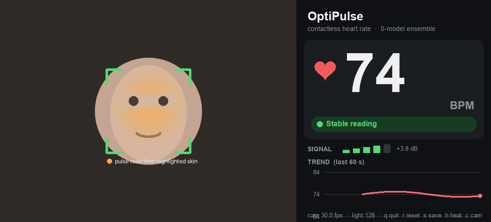

# Using OptiPulse

How to install and run the live app, what every option and on-screen element means, what the log files
contain, and how to test the system against a reference device. For how the code works, see
[EXPLAIN.md](EXPLAIN.md).

> OptiPulse is a research prototype, **not a medical device**. Do not use it for diagnosis or treatment.

---

## 1. Installation

All commands run from the **repository root**. The launchers find the root on their own.

### Windows (NVIDIA GPU or CPU)

Double-click `launchers\windows\run_windows.bat`, or run it from a terminal. On the first run it:

1. finds a 64-bit Python 3.9+, and offers to install Python 3.12 with `winget` if there is none;
2. creates a private environment in `.venv`;
3. installs PyTorch (the CUDA build that matches the NVIDIA driver, read from `nvidia-smi`, or the CPU
   build when there is no NVIDIA GPU) and `requirements.txt`. It also checks for the Visual C++ runtime.

The first run downloads ~3 GB and takes 5–15 minutes. Later runs start in seconds. To reinstall,
delete `.venv` and run the launcher again.

The launcher starts `python -m optipulse --camera 0 --always_show --save_raw auto`, and adds
`--ensemble 2` when there is no CUDA GPU. Any extra arguments are passed to the app:

```bat
launchers\windows\run_windows.bat --camera 1
launchers\windows\run_windows.bat --list_cameras
```

### macOS (Apple silicon or Intel)

```bash
bash launchers/macos/run_mac.sh
```

* **Needs Python 3.11 or 3.12** (from python.org or Homebrew). On the first run it creates `.venv`,
  downloads ~1.5 GB and takes 5–10 minutes.
* **Apple silicon** gets current PyTorch and uses the Apple GPU (MPS), but only if MPS results match the
  CPU. Otherwise it falls back to the CPU.
* **Intel Macs** get PyTorch 2.2.2, the last release for Intel macOS, and run on the CPU.
* The launcher runs `--camera 0 --ensemble 2 --always_show --save_raw auto` with
  `PYTORCH_ENABLE_MPS_FALLBACK=1` and passes extra arguments through. Two models need about 1–1.5 GB of
  RAM, which suits an 8 GB Mac.
* **First run:** macOS asks for camera access for Terminal. If the window stays black, allow it under
  **System Settings → Privacy & Security → Camera** and restart Terminal.

### Any OS, manually

```bash
python -m venv .venv
source .venv/bin/activate                 # Windows: .venv\Scripts\activate
pip install torch torchvision             # for NVIDIA, pick the CUDA build at https://pytorch.org
pip install -r requirements.txt
python -m optipulse --ensemble 2
```

Requirements: Python 3.9+, PyTorch ≥ 2.4 (2.2.2 on Intel Macs), NumPy, SciPy, OpenCV, Pillow and
Ultralytics (see `requirements.txt`).

### Hardware and speed

| Device | Models | Time per HR update (every 0.5 s) |
|---|---|---|
| NVIDIA RTX 3070 Ti Laptop | 10 | ~0.33 s |
| Apple M4 (MPS) | 2 | ~0.4 s per model |
| Laptop CPU | 2 | ~1.8 s (updates arrive less often; accuracy is unaffected) |

---

## 2. Getting a good reading

The pulse is a 0.2–1 % brightness change on the skin, so the conditions matter more than the hardware.

* **Light in front of you.** A lamp or window behind the camera, pointing at your face. A bright window
  behind you is the most common cause of failure, because auto-exposure then darkens the face.
* **Distance 50–70 cm.** Your face should take up about a third of the frame height.
* **Stay still and don't talk** for the first 15 seconds and during the measurement.
* **Turn off camera effects:** macOS Video Effects (Portrait, Studio Light, Center Stage), Windows Studio
  Effects, beauty and background filters, and phone HDR or stabilisation. They change pixel values
  frame by frame.
* Take glasses off if possible, and keep hair off the forehead.
* On Windows, press `c` in the app to open the camera driver dialog. If the driver allows it, turn off
  auto-exposure and auto white balance.

The first number appears after 8–15 seconds.

---

## 3. Command-line options

`python -m optipulse --help` prints this list.

### Input

| Option | Default | Meaning |
|---|---|---|
| `--camera` | `0` | camera index, or a stream URL (e.g. `http://<phone-ip>:4747/video`, see §8) |
| `--list_cameras` | – | print every working camera index and backend, then exit |
| `--backend` | `auto` | Windows camera API: `dshow`, `msmf` or `any` |
| `--cam_fps` | `30` | frame rate requested from the camera. Above 30 fps, frames are averaged into 1/30-s slots |
| `--fourcc` | `auto` | stream format: `MJPG`, `YUY2`, `NV12` (auto: MJPG for dshow, NV12 for msmf) |
| `--video FILE` | – | process a video file instead of a camera. A `<name>_timestamps.csv` next to it is used automatically |
| `--ubfc subN` | – | run on a UBFC-rPPG subject and score against ground truth (needs `data/`) |

### Models and compute

| Option | Default | Meaning |
|---|---|---|
| `--ensemble N` | `10` | number of models loaded from `models/vitalnet/`, alternating MRC and Pix |
| `--weights a.pt b.pt` | – | use exactly these checkpoints |
| `--device` | `auto` | `cuda`, `mps` or `cpu` (auto: NVIDIA, then verified Apple GPU, then CPU) |
| `--cpu` | – | same as `--device cpu` |
| `--yolo PATH` | bundled | face-detector weights |
| `--det_every N` | `0` (auto) | run the face detector every N frames on CUDA or offline (auto: 2 at 30 fps, 4 at 60 fps) |

### Estimation and display

| Option | Default | Meaning |
|---|---|---|
| `--window` | `10` | analysis window in seconds |
| `--min_window` | `6` | seconds of video needed before the first estimate |
| `--update` | `0.5` | seconds between HR updates |
| `--no_track` | – | turn off the HMM tracker; show the median of recent per-window estimates instead |
| `--snr_min` | `0` | with `--no_track`: ignore windows below this SNR (dB) |
| `--always_show` | – | always show the value after lock; weak readings appear in amber instead of being hidden |
| `--view_h` | `640` | height of the camera view in the window, in pixels |

### Output

| Option | Default | Meaning |
|---|---|---|
| `--csv PATH` | `outputs/hr_log_<time>.csv` | where to write the HR log |
| `--save_raw NAME` | – | save raw frames losslessly. `auto` writes `outputs/raw_<time>.mkv` plus `raw_<time>_timestamps.csv` |
| `--record PATH.mp4` | – | record the rendered app window (camera view and panel) as MP4 |
| `--headless` | – | no window; useful with `--video` or `--ubfc` |

---

## 4. The window



**Left: the camera view.** Corner brackets mark the tracked face. Their colour follows the state: blue
while measuring, green when the reading is stable, amber when it is weak. The warm glow shows the skin
the network reads the pulse from; press `h` to toggle it.

**Right: the panel.**

| Element | Meaning |
|---|---|
| Big number | heart rate in BPM. The heart icon beats at that rate |
| State chip | `Measuring...` (with a countdown), `Stable reading`, `Low confidence reading`, `Pulse signal too weak – no reading`, or `No face found` |
| Signal bars (0–5) | pulse signal quality. One bar for each of −4, −2, 0, +2 and +4 dB that the 5-s median SNR exceeds |
| Trend | the last 60 s of displayed values |
| Waveform | the live pulse signal the networks extract |
| Hint line | the most likely problem, in priority order: too dark, too close, too far, low frame rate, head moving, light behind you, weak pulse |
| Footer | camera fps and face brightness |

**When a number appears:**

1. **Lock.** No number is shown until the tracker is confident (≥ 0.60), or until 20 s have passed.
2. **Slew limit.** After locking, the number changes by at most 3 BPM/s, or 9 BPM/s when the tracker is
   very confident.
3. **Honesty gate.** If the 5-s median SNR falls below −1.5 dB, the number is hidden and the chip says
   the pulse is too weak. With `--always_show`, the number is shown in amber instead.

**Keys**

| Key | Action |
|---|---|
| `q` / Esc | quit |
| `r` | reset the measurement |
| `s` | save a screenshot to `outputs/` |
| `f` | toggle fullscreen |
| `h` | toggle the pulse-region glow |
| `c` | camera driver settings (Windows only) |

---

## 5. Output files

Everything goes to `outputs/`, which is git-ignored. These files contain images of faces, so do not
share them without consent.

### The CSV log

`outputs/hr_log_<time>.csv` gets one row per completed HR update (about every 0.5 s on a GPU).

| Column | Meaning |
|---|---|
| `t_s` | seconds since the start |
| `hr_bpm` | displayed (tracked, slew-limited) HR. 0 before lock |
| `raw_hr_bpm` | median of the per-model spectral peaks in this window, before tracking |
| `snr_db` | pulse SNR of this window (dB). ≥ 0 is decent, ≥ 3 is clean, ≤ −3 is mostly noise |
| `confidence` | tracker confidence, 0–1 (consistency over time, *not* signal quality) |
| `rppg_fps` | effective frame rate of the analysed window |
| `shown` | 1 if a number was on screen (locked and passed the gate, or `--always_show`) |
| `gt_hr_bpm` | ground-truth HR (only with `--ubfc`) |
| `snr_avg_db` | 5-s median SNR, the value the gate and signal bars use |
| `head_motion` | face-centre movement over 4 s divided by face size (> 0.10 counts as moving) |
| `face_light`, `bg_light` | mean brightness (0–255) of the face and of the background. Face < 0.65 × background means backlit |

### Raw recordings and replay

`--save_raw auto` writes the untouched camera frames to `outputs/raw_<time>.mkv`, using the lossless
FFV1 codec (MJPG `.avi` if FFV1 is unavailable). It also writes `raw_<time>_timestamps.csv` with the
columns `frame,t_s` holding the real capture times. Replaying such a recording gives the same pipeline
the same input:

```bash
python -m optipulse --video outputs/raw_<time>.mkv                               # with the window
python -m optipulse --video outputs/raw_<time>.mkv --headless --csv replay.csv   # fast, CSV only
```

This is the easiest way to compare settings or code versions on one session (`--no_track`,
`--ensemble 10`, a different `--window`, and so on).

---

## 6. Testing against a reference device

You need a pulse oximeter, chest strap, smartwatch or gym-machine reading.

1. Set up as in §2. Start the app with `--always_show --save_raw auto`.
2. Sit still for **2 minutes**, without talking.
3. **Every 15 seconds**, write down the app's time (the CSV's `t_s` counts from start-up) and the
   reference reading.
4. Optional: do ~30 squats and record a second session, to see whether the app follows a falling HR.
5. Compare your written values against `hr_bpm` at the same `t_s`, using only rows where `shown = 1`.
   Also check `snr_avg_db`. If it stays below −1.5 dB, the camera did not capture a usable pulse, and
   the problem is the setup (light, distance, camera effects), not the HR value.

Keep the raw recording. With it, the session can be re-analysed later with improved code (§5).

---

## 7. Scoring on UBFC-rPPG

Scoring needs the dataset in `data/raw/UBFC-rPPG/` (see the root README for the layout). Score a
subject with models that never saw that person; the fold lists are stored in each checkpoint and in
`results/metrics/cv_results_pix.json`:

```bash
python -m optipulse --ubfc sub42 --weights models/vitalnet/pix_fold0.pt models/vitalnet/mrc_fold0.pt --headless
# MAE 0.64 BPM
```

Without `--weights`, the deployed ensemble includes models trained on that subject, so the result is
optimistic.

---

## 8. Troubleshooting

| Symptom | What to try |
|---|---|
| Black window or "camera not found" | Close other apps using the camera (Zoom, Teams, browser tabs). Run `--list_cameras` and pick the index. On macOS, allow camera access for Terminal |
| "No face found" with a face visible | More light. Face the camera. Sit closer (face ≥ 18 % of the frame height) |
| Stuck on "Pulse signal too weak" | Put the light in front of you, not behind. Turn off video effects. Hold still. Check `snr_avg_db` and `face_light` vs `bg_light` in the CSV |
| Value jumps around (with `--always_show`) | The signal is weak. The amber colour already says so. Fix the conditions above |
| Low fps hint | Close other programs. Use `--ensemble 2`. Try `--fourcc MJPG` on Windows |
| `[engine] inference error` on a Mac | Run with `--device cpu` and report the printed traceback |
| Phone as camera (Windows, DroidCam PC client) | `--camera 1 --backend msmf --cam_fps 60` (the index may differ; check `--list_cameras`) |
| Phone directly over Wi-Fi (DroidCam app) | `--camera http://<phone-ip>:4747/video`. Note: this mode is currently broken by a bug in `Camera.__init__` (see [EXPLAIN.md §13](EXPLAIN.md#13-limitations-and-known-issues)) |
| Slow first start | The first run of YOLO and PyTorch initialises caches. Later starts are faster |
