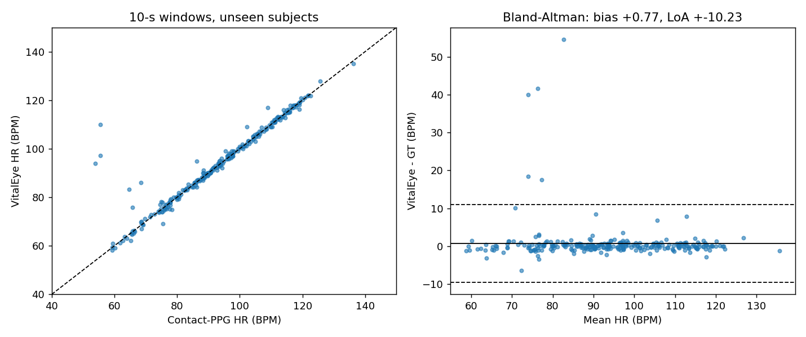
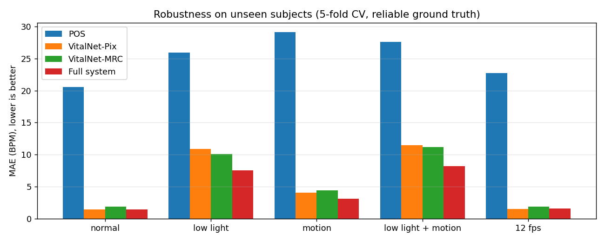
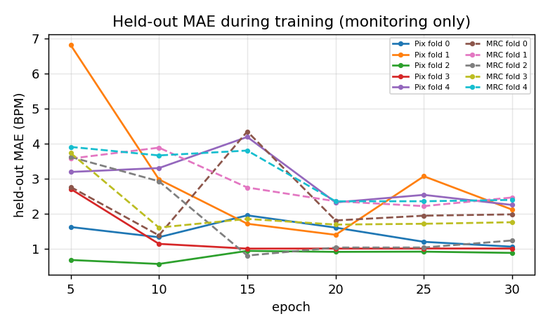
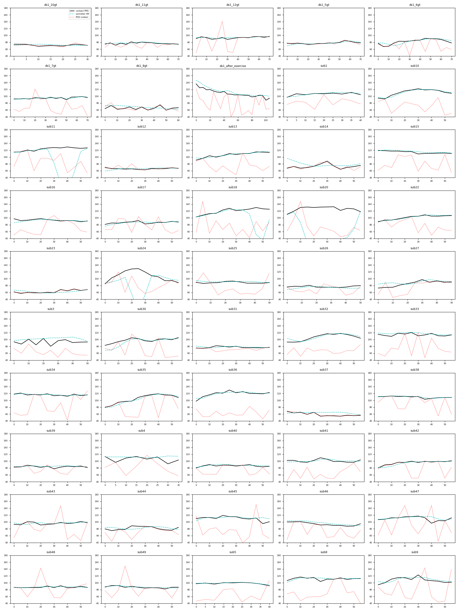

# VitalEye - Results

**Protocol.** Subject-wise 5-fold cross-validation on UBFC-rPPG (50 videos): every number below comes from models that never saw that person. Heart rate per non-overlapping 10-s window, same spectral estimator for prediction and contact-PPG ground truth (39-192 BPM, no HR prior). Fixed training schedule, last epoch, no checkpoint selection on test data. Stress conditions are deterministic (same seed for every method). Main tables: the 43 subjects whose contact-PPG passed the audit; flagged subjects (sub11, sub14, sub18, sub20, sub24, sub3, sub4) are reported separately.

**Tracked** = causal HMM decoding (uses only the current and past 10-s windows; usable live).

## 1. Main result - MAE (BPM) on unseen subjects, reliable ground truth (n=43)

| Method | normal | low light | motion | low light + motion | 12 fps |
|---|---|---|---|---|---|
| GREEN (classical) | 15.53 | 21.94 | 36.21 | 30.41 | 17.14 |
| CHROM (classical) | 17.36 | 22.45 | 23.51 | 21.96 | 18.60 |
| POS (classical) | 20.56 | 25.97 | 29.17 | 27.64 | 22.74 |
| VitalNet-Pix (v1, single model) | 1.42 | 10.91 | 4.06 | 11.47 | 1.50 |
| VitalNet-MRC (v4 + consistency, single model) | 1.89 | 10.09 | 4.42 | 11.20 | 1.85 |
| Pix + tracking | 1.56 | 8.02 | 3.48 | 9.92 | 1.55 |
| MRC + tracking | 1.81 | 7.32 | 3.99 | 9.02 | 1.66 |
| Pix + MRC spectral fusion (no tracking) | 1.46 | 9.77 | 3.59 | 10.72 | 1.43 |
| **VitalEye full system** (Pix + MRC fusion + tracking) | 1.45 | 7.55 | 3.12 | 8.23 | 1.59 |

Full system, all metrics:

| Condition | MAE | RMSE | MAPE % | Pearson r | within 5 BPM | within 10 BPM | windows |
|---|---|---|---|---|---|---|---|
| normal | 1.45 | 5.28 | 2.0 | 0.948 | 96.3% | 97.8% | 270 |
| low light | 7.55 | 13.89 | 9.1 | 0.629 | 66.3% | 74.4% | 270 |
| motion | 3.12 | 8.14 | 3.9 | 0.871 | 87.8% | 91.1% | 270 |
| low light + motion | 8.23 | 14.67 | 9.4 | 0.557 | 64.8% | 72.6% | 270 |
| 12 fps | 1.59 | 5.15 | 2.1 | 0.951 | 95.2% | 96.7% | 270 |

## 2. Audit-flagged subjects (n=7, CV held-out models, full system)

| Subject | normal | low light | motion | low light + motion | 12 fps |
|---|---|---|---|---|---|
| sub11 | 1.00 | 8.56 | 0.98 | 19.76 | 0.99 |
| sub14 | 4.51 | 14.47 | 5.69 | 11.81 | 4.64 |
| sub18 | 0.75 | 2.79 | 0.83 | 3.36 | 0.75 |
| sub20 | 3.27 | 20.61 | 3.03 | 5.32 | 3.55 |
| sub24 | 1.04 | 6.76 | 1.25 | 13.89 | 1.22 |
| sub3 | 0.51 | 7.60 | 5.24 | 4.56 | 0.55 |
| sub4 | 6.18 | 12.54 | 5.77 | 6.57 | 5.42 |

### Deployed 10-model ensemble on the 7 people no model was ever trained on

| Subjects | normal | low light | motion | low light + motion | 12 fps |
|---|---|---|---|---|---|
| sub11/18/20/24 (PPG verified) plain | 0.79 | 11.66 | 1.16 | 15.79 | 0.79 |
| sub11/18/20/24 (PPG verified) tracked | 1.29 | 15.29 | 1.34 | 16.07 | 1.62 |
| sub3/4/14 (noisy contact PPG) plain | 3.28 | 12.67 | 4.01 | 10.61 | 3.18 |
| sub3/4/14 (noisy contact PPG) tracked | 3.29 | 10.52 | 5.01 | 8.20 | 3.32 |

Only 7 people, so this is a small-sample check: in low light tracking *hurt* the 4 verified subjects here (the tracker can follow a wrong peak for a few windows, e.g. sub11), although it helped clearly on the 43-subject CV (Section 1). The live app has `--no_track` to switch it off.

## 3. Development ablation (fold 0 only, 10 unseen subjects, MAE BPM)

Used to choose the design; single-fold numbers move by +-1 BPM between identical re-runs, so only large effects were trusted, and the chosen system was then evaluated on all 5 folds (Section 1).

| Variant | normal | low light | motion | low light + motion | 12 fps | normal tracked | low light tracked | motion tracked | low light + motion tracked |
|---|---|---|---|---|---|---|---|---|---|
| run 1 = Pix v1 | 1.06 | 8.61 | 3.76 | 9.77 | 1.02 | 1.05 | 6.16 | 3.55 | 7.43 |
| run 2: harder augmentation, 40 ep | 1.08 | 9.00 | 8.25 | 13.00 | 1.30 | - | - | - | - |
| v3: temporal pre-filter stem | 2.14 | 11.23 | 3.91 | 13.52 | 2.38 | - | - | - | - |
| v4: + region-MRC branch + noise gate | 1.86 | 7.29 | 3.57 | 9.24 | 2.84 | 1.36 | 6.33 | 2.81 | 7.12 |
| v4 + low-light consistency (= MRC) | 1.98 | 7.92 | 4.14 | 11.44 | 2.62 | 1.32 | 5.80 | 3.01 | 8.06 |
| ens Pix + v4 | 1.27 | 8.30 | 3.11 | 9.21 | 1.25 | 1.00 | 6.35 | 2.25 | 6.14 |
| ens Pix + MRC | 1.28 | 7.68 | 2.71 | 9.61 | 1.26 | 1.01 | 6.31 | 2.37 | 5.92 |
| ens Pix + v4 + MRC | 1.50 | 8.14 | 2.91 | 9.61 | 1.47 | 1.25 | 5.97 | 2.36 | 6.18 |

## 4. Per-subject MAE, full system (CV)

| Subject | GT reliable | mean GT HR | normal | low light | motion | low light + motion | 12 fps |
|---|---|---|---|---|---|---|---|
| ds1_10gt | yes | 71 | 1.2 | 8.0 | 0.9 | 1.7 | 1.3 |
| ds1_11gt | yes | 75 | 0.7 | 9.6 | 9.6 | 8.9 | 0.7 |
| ds1_12gt | yes | 93 | 0.8 | 3.2 | 1.6 | 13.8 | 0.8 |
| ds1_5gt | yes | 78 | 0.7 | 2.1 | 1.3 | 4.7 | 0.8 |
| ds1_6gt | yes | 82 | 1.0 | 10.9 | 7.5 | 8.1 | 1.1 |
| ds1_7gt | yes | 94 | 0.7 | 12.4 | 4.7 | 11.9 | 1.7 |
| ds1_8gt | yes | 65 | 4.8 | 33.2 | 17.0 | 9.1 | 5.1 |
| ds1_after_exercise | yes | 110 | 1.2 | 13.8 | 13.3 | 15.8 | 4.1 |
| sub1 | yes | 104 | 1.0 | 3.7 | 1.3 | 5.0 | 0.8 |
| sub10 | yes | 111 | 0.8 | 5.6 | 3.4 | 16.1 | 0.9 |
| sub11 | no | 124 | 1.0 | 8.6 | 1.0 | 19.8 | 1.0 |
| sub12 | yes | 67 | 0.7 | 8.1 | 0.7 | 8.4 | 0.6 |
| sub13 | yes | 106 | 0.6 | 5.1 | 0.8 | 4.6 | 0.7 |
| sub14 | no | 72 | 4.5 | 14.5 | 5.7 | 11.8 | 4.6 |
| sub15 | yes | 114 | 1.9 | 3.3 | 1.9 | 14.3 | 1.9 |
| sub16 | yes | 94 | 0.5 | 3.2 | 0.6 | 1.6 | 0.5 |
| sub17 | yes | 86 | 0.4 | 0.7 | 0.5 | 2.4 | 0.4 |
| sub18 | no | 118 | 0.7 | 2.8 | 0.8 | 3.4 | 0.8 |
| sub20 | no | 126 | 3.3 | 20.6 | 3.0 | 5.3 | 3.6 |
| sub22 | yes | 100 | 0.5 | 7.7 | 0.7 | 6.0 | 0.5 |
| sub23 | yes | 62 | 0.5 | 5.1 | 0.5 | 32.5 | 0.6 |
| sub24 | no | 107 | 1.0 | 6.8 | 1.2 | 13.9 | 1.2 |
| sub25 | yes | 90 | 0.5 | 2.2 | 1.0 | 4.6 | 0.5 |
| sub26 | yes | 77 | 1.8 | 8.6 | 2.0 | 15.5 | 2.2 |
| sub27 | yes | 86 | 1.2 | 3.1 | 2.1 | 3.8 | 1.2 |
| sub3 | no | 97 | 0.5 | 7.6 | 5.2 | 4.6 | 0.5 |
| sub30 | yes | 96 | 0.7 | 4.9 | 0.9 | 2.0 | 0.7 |
| sub31 | yes | 78 | 1.1 | 9.5 | 1.1 | 0.9 | 1.0 |
| sub32 | yes | 106 | 0.8 | 8.1 | 4.0 | 6.5 | 1.0 |
| sub33 | yes | 113 | 0.5 | 7.0 | 0.5 | 9.0 | 0.6 |
| sub34 | yes | 115 | 0.5 | 11.7 | 0.4 | 22.7 | 0.6 |
| sub35 | yes | 103 | 0.2 | 0.5 | 0.4 | 2.8 | 0.2 |
| sub36 | yes | 116 | 0.1 | 11.6 | 0.4 | 7.9 | 0.1 |
| sub37 | yes | 61 | 26.3 | 37.7 | 23.2 | 24.4 | 23.9 |
| sub38 | yes | 110 | 0.2 | 0.8 | 0.5 | 2.0 | 0.2 |
| sub39 | yes | 84 | 0.8 | 6.7 | 1.0 | 1.4 | 0.8 |
| sub4 | no | 106 | 6.2 | 12.5 | 5.8 | 6.6 | 5.4 |
| sub40 | yes | 86 | 0.3 | 1.4 | 0.4 | 3.3 | 0.4 |
| sub41 | yes | 101 | 1.8 | 13.0 | 1.7 | 2.1 | 1.8 |
| sub42 | yes | 93 | 0.5 | 2.4 | 0.7 | 2.0 | 0.4 |
| sub43 | yes | 97 | 0.3 | 1.8 | 0.5 | 0.9 | 0.3 |
| sub44 | yes | 82 | 0.4 | 5.0 | 2.0 | 5.5 | 0.5 |
| sub45 | yes | 110 | 1.6 | 8.4 | 1.5 | 15.6 | 1.8 |
| sub46 | yes | 95 | 0.3 | 1.0 | 0.6 | 3.0 | 0.4 |
| sub47 | yes | 109 | 0.5 | 3.9 | 0.5 | 5.8 | 0.5 |
| sub48 | yes | 87 | 2.0 | 10.9 | 0.9 | 2.4 | 1.9 |
| sub49 | yes | 88 | 0.5 | 1.3 | 0.4 | 1.3 | 0.5 |
| sub5 | yes | 97 | 0.7 | 8.7 | 1.1 | 8.3 | 0.9 |
| sub8 | yes | 113 | 0.2 | 3.1 | 0.4 | 16.9 | 0.3 |
| sub9 | yes | 108 | 0.9 | 5.8 | 5.0 | 7.1 | 1.0 |

## 5. Signal quality (ensemble SNR) vs per-window error (no tracking)

| SNR | windows | MAE | within 5 BPM |
|---|---|---|---|
| -99 .. -6 dB | 9 | 11.63 | 33.3% |
| -6 .. -3 dB | 214 | 14.41 | 43.9% |
| -3 .. 0 dB | 429 | 7.76 | 69.7% |
| 0 .. 3 dB | 315 | 1.75 | 95.9% |
| 3 .. 6 dB | 295 | 0.61 | 99.7% |
| 6 .. 99 dB | 88 | 0.40 | 100.0% |

## 6. Full live pipeline, frame by frame on the raw videos (what the app displays)

YOLO face detection -> crops -> HR engine updated every 0.5 s; each displayed HR vs contact-PPG HR of the preceding 10 s. vitaleye = held-out pix_+mrc_ fold models with tracking; legacy_physformerx = the old project monitor.

| Pipeline | subjects | MAE | RMSE | within 5 BPM | updates |
|---|---|---|---|---|---|
| vitaleye_v2 | reliable GT | 1.59 | 4.88 | 95.9% | 5268 |
| vitaleye_v2 | all 50 | 1.72 | 4.89 | 94.6% | 6055 |
| legacy_physformerx | reliable GT | 6.81 | 11.30 | 63.4% | 4969 |
| legacy_physformerx | all 50 | 7.71 | 12.80 | 60.5% | 5718 |

## Figures

